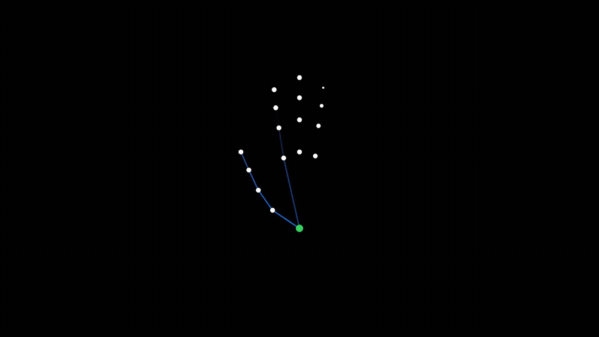

# gesture

Watch your hand through the webcam, press keyboard shortcuts on your machine.

A browser page reads 21 hand landmarks with MediaPipe and works out which gesture
you're making. When it spots one, it sends the gesture *name* to a small Node
server on localhost, which presses the matching shortcut. An OK sign arms and
disarms the page, an open hand held still plays or pauses music, a fist locks
the screen, a 4-finger swipe sideways moves between Spaces and up or down pages
a document, and a finger on your lips mutes Zoom. See [Gestures](#gestures) for
each one and where it came from.

It also knows which of your screens you're looking at. Look at a monitor and
pinch, and its front window comes forward. See
[Spatial desk](#spatial-desk-look-then-pinch).

Every mapping lives in [`config.json`](config.json). Change what a gesture does by
editing that file — the server picks it up on save, no restart and no code changes.

```
browser: camera -> landmarks -> gesture name  --POST-->  server: shortcut -> key press
```

## Watch it



Fifteen seconds of it running. The **[full 71-second walkthrough](docs/gesture-film.mp4)**
has sound and covers the four problems that shaped the architecture: why
detection had to move into a Web Worker, why macOS refuses a Space switch it
didn't press, why one backend structurally *cannot* send one, and how an open
palm is told apart from a swipe that looks identical to it.

Contributing, or want to know how it works inside?
**[ARCHITECTURE.md](ARCHITECTURE.md)** covers the whole system end to end — the
three processes, the detection pipeline, why the UI runs in Chrome, how key
injection works on macOS, and the traps.

## Desktop app: the orb

The desktop app in [`src-tauri/`](src-tauri) turns Gesture into a small orb
under your camera: a small notch of Liquid Glass fused to the top edge of
the built-in screen, with Jelly, Gesture's mascot, in it. To say something
it grows sideways, with a few words beside Jelly. The glass is macOS 26's
own; on older macOS the notch is dark instead.

- It starts with your Mac (**Start at Login**) and says good morning (or
  afternoon, or evening) when you log in and every time you open the lid.
- **Click it** to turn the camera on. Jelly looks up, thinking, while hand
  tracking loads, then lights the glass around it: softly while disarmed, in
  full when armed. Its eyes turn toward the screen you face. With the camera
  off it covers its eyes: it isn't looking.
- When a gesture works, Jelly says so for a moment, in its own words, with
  the face to match: "I'm awake" when you arm it, "Going to sleep" when you
  disarm it, "Hey, I'm looking" for a desktop swipe. When something's wrong it
  says that too ("I can't see you", "Mac blocked me"). The detail, what exactly
  happened and how to fix it, is read out by VoiceOver.
- **Right-click** for Settings (the full page described below), Start at Login
  and Quit.
- Clicking it never takes focus from the app you're typing in, and it shows on
  every desktop and over full-screen apps.

The camera and detection run in a Chrome window of Gesture's own (its own
profile, separate from your browsing), kept hidden. It is the same page as
below, and it is the Settings window. A MacBook Air M1 has no notch, so there
the orb sits over the empty middle of the menu bar.

```bash
npm run app:dev     # run it
npm run app:build   # produce Gesture.app
```

**To have it start with your Mac,** build it from the project folder you
keep (`~/code/gesture`), copy
`src-tauri/target/release/bundle/macos/Gesture.app` to `/Applications`,
open it once, and turn on **Start at Login** from the orb's right-click menu.
The installed app runs its server from the folder it was built in, so keep
that folder. It also needs Accessibility of its own (System Settings →
Privacy & Security → Accessibility), since the grant is per app and
`npm run app:dev` borrows the terminal's. Quit it before
`npm run app:dev`, or there will be two orbs.

Needs a Rust toolchain (<https://rustup.rs>), Google Chrome and Apple's
Command Line Tools (for Swift: the orb's island is SwiftUI) on top of the
normal setup. The first time you click the orb, Chrome asks for the camera in
the Gesture window, which the orb brings forward for you; after that it stays
hidden. In a browser, <http://127.0.0.1:4321/orb.html> shows Jelly with the
orb's words under it.

### Why the UI is in Chrome and not in the app

Because only one of the two engines can detect while the window is not visible,
and the page reports which it is at load:

| Engine | `MediaStreamTrackProcessor` | Detection path | Works hidden |
| --- | --- | --- | --- |
| Chrome | **yes** | Worker fed by `MediaStreamTrackProcessor` | **yes** |
| Tauri's WKWebView | **no** | `requestVideoFrameCallback` on the main thread | no |

WebKit freezes `requestVideoFrameCallback` for any non-visible page, so in a
webview the app can only detect while a window is on screen. Chrome keeps
detecting with the window minimised, because browsers do not throttle workers and
the visibility handler deliberately does nothing in worker mode.

`backgroundThrottling: "disabled"` does not close the gap — measured, it keeps
the main thread scheduled (heartbeats keep arriving) but does not restore frame
delivery (`msSinceFrame` grows without bound). Rendering the UI natively would
mean reimplementing camera capture and inference in Rust to reach a place Chrome
already occupies. The orb, start-at-login and server supervision are worth
having natively; detection in a webview was not. The orb's webview only draws,
and has no camera.

Confirm any of this yourself with `GET /recent`, which records each client's
engine and capabilities.

### What the host does

- Starts `node server/index.js` as a child, or attaches to a server already on
  the port — so `npm start` in a terminal and the app stay interchangeable.
- Shows the orb once the server answers, and runs the page in a Chrome window
  of its own (its own profile, at `/?engine=1`), kept hidden. **Gestures keep
  firing with it hidden.** Right-click → **Settings** brings that window
  forward.
- **Start at Login**, reflecting the LaunchAgent's real state rather than a
  stored preference. An installed app rewrites the LaunchAgent with its own
  path each time it starts, so moving or replacing the app doesn't leave it
  pointing at nothing.
- **After sleep the camera comes back on its own.** Closing the lid locks the
  screen and Chrome suspends the camera; it can also end the camera outright.
  Jelly says "Waking up…" and the camera is tried again, more slowly each
  time, until it is back or you click the orb off.
- **Quit Gesture** exits, quits the hidden Chrome, and kills the server it
  started. The server also watches its parent and exits on its own if the app
  is force-killed, so no orphan is left holding port 4321.

If Chrome is missing, the app says so in the terminal and the orb says so in
words: the camera page needs Chrome.

**The Accessibility grant follows whatever started the server.** It is the
responsible app that needs ticking — `Gesture` for the bundled app, your
terminal for `npm run app:dev` or `npm start` — and the two are separate
entries. Gestures look perfectly healthy when this is wrong: the page detects,
fires, and POSTs, and the server answers `accessibility-denied` while no key is
ever pressed. `GET /health` names the app to enable, and so does the orb.

### Permissions

The Accessibility grant follows the *responsible* app, so when the server is
started by the bundled app it is `Gesture` that needs ticking, not your editor.
`Info.plist` declares `NSAppleEventsUsageDescription`, which is what lets the
Automation prompt appear for the `osascript` Space strategy — without it Space
switching fails with error 1002.

**An unsigned build loses the grant every time it is rebuilt.** An ad-hoc
signature's designated requirement is the hash of that exact binary:

```
$ codesign -d -r- Gesture.app
designated => cdhash H"345fb776bbf1a998f3e9c28d2fec2642d5a58b9a"
```

So macOS treats each rebuild as a different application. If the box is already
ticked and access is still denied, remove the entry with **−** and add it again.
Signing with a real or self-signed certificate makes the requirement name the
identifier and certificate instead, and the grant then survives rebuilds.

Bundling the Node runtime into the `.app` is **not** solved: a built app still
expects `node` on `PATH` and the project directory present. `GESTURE_ROOT` and
`GESTURE_NODE` override the search.

## Requirements

- **Node 22 or newer** (developed on 26.4)
- **macOS** for the key-press half. The browser half is cross-platform, but both
  keyboard backends are macOS-only right now.

## Setup

```bash
npm install
```

```bash
npm run build:native
```

```bash
npm start
```

`build:native` compiles an ~800-line Swift helper with the Xcode command line
tools. It is optional but strongly recommended: **without it, Space switching does
not work at all** — see *Backends* below. Everything else works either way.

Then open <http://127.0.0.1:4321>. The **Setup** checklist on Home walks you through
the rest:
- allow key presses;
- start the camera;
- calibrate your screens;
- arm.

Each step ticks itself off once it's true.

Nothing is sent to the server until you arm it. Press <kbd>Esc</kbd> at any time to
disarm.

### The app

- **Status bar** (across the top): camera, armed, which screen you face, whether
  keys can be pressed, and sound. Each chip is a word, not only a colour.
  Click **Armed** to toggle it; click any other chip for the detail.
- **The mascot** (top left, and in the orb under the camera with the desktop app):
  Gesture's state as a face, so you can read it while the page is hidden.
  - Asleep when disarmed, watching when a hand is in view.
  - A ring fills while you hold a pose.
  - A nod when a gesture works, a shrug when one is refused.
  - Its eyes turn toward the screen you're facing.

  Hover it for the same thing in words. It never pops up or asks for anything,
  and it stays still during the check-up. Hide the header face in **Settings**. The art
  is a placeholder: [docs/MASCOT.md](docs/MASCOT.md) is the brief for the real
  thing.
- **Sidebar sections:**
  - **Home**: what Gesture sees right now, in plain words, with a small camera
    preview and the setup checklist.
  - **Gestures**: choose what each gesture does from a list, plus your taught
    gestures. Each choice is saved to `config.json` straight away.
  - **Screens**: the desk map and calibration.
  - **Measure**: the check-up.
  - **Lab** (experimental): snap your fingers and turn to dust. See
    [The Lab](#the-lab-snap-and-vanish).
  - **Settings**: what `config.json` currently says.
- **Diagnostics** (top right): the detector's raw readout (palm speed, swipe
  state, backend…) and the full activity log. It's kept out of the way because
  most people never need it.

The page follows your Mac's light or dark appearance. Below 860 px wide, the
sidebar becomes a row of tabs.

### Grant Accessibility access first

macOS silently discards synthetic key events from apps without Accessibility
access. Not an error — the press just does nothing, which looks exactly like a
broken gesture detector.

**System Settings → Privacy & Security → Accessibility** → enable the terminal app
you run `npm start` from (Terminal, iTerm, VS Code, …), then restart the server.

The server checks this at startup and refuses to be quiet about it: you'll get a
warning in the console and a banner on the page if it's missing.

### For the swipe gestures

You need **more than one Space** for anything to be visible — add desktops in
Mission Control. Use the **test** button next to `swipe_left` in the UI to check
this independently of hand tracking.

You do *not* need the Mission Control keyboard shortcuts for this. The default
bindings are `space_right` / `space_left`, which route through System Events
rather than injecting `ctrl+←`/`→` directly — because on macOS 26 a directly
injected keystroke cannot switch Spaces. See *Why Spaces don't respond to a key this process presses*.

## Gestures

The set is **locked** (24 Oct 2026, adjusted by choice on 25 Oct after trying it
live). Most movements were picked from published gesture studies; the two that
weren't are marked. `test/config.test.js` fails if a default changes without that
test changing too.

| Gesture       | How                                              | Default binding | Does         | Why this movement |
| ------------- | ------------------------------------------------ | --------------- | ------------ | ----------------- |
| `ok_sign`     | thumb and index in a circle, other three up, **0.5 s** | `toggle_armed`  | arm / disarm | "Yes" in a mid-air TV gesture study (Dim et al., *DIS '16*) |
| `pinch`       | **look at a screen**, then thumb and index together | `focus_screen`  | bring that screen's window forward | Look-then-pinch is how Vision Pro selects ([Apple](https://support.apple.com/en-asia/117741)) |
| `open_palm`   | all five out, **held still for 1.2 s**           | `audio_play`    | play / pause | Chosen live on 25 Oct. Holding an open hand still for over a second before a swipe up/down also toggles music |
| `fist`        | all fingers curled                               | `cmd+ctrl+q`    | lock screen  | Chosen live on 25 Oct. The camera reads a **thumbs-up or a resting fist as a fist**, so it can lock the Mac by accident |
| `swipe_left`  | four fingers out, hand travels **left**          | `space_right`   | next desktop | The same as a Mac trackpad |
| `swipe_right` | four fingers out, hand travels **right**         | `space_left`    | previous desktop | |
| `shh`         | **index finger upright on your lips**, 0.4 s     | `cmd+shift+a`   | mute mic (Zoom) | A candidate: common, but no study tests it for mute, and it's cultural. It stays only if the check-up shows ≥ 90% success with no misfires |
| `swipe_up`    | four fingers out, hand travels **up**            | `pagedown`      | scroll down a page, while you write | Palm up/down for up/down controls (Dim et al., *DIS '16*). The page moves with your hand, like a trackpad |
| `swipe_down`  | four fingers out, hand travels **down**          | `pageup`        | scroll up a page | |

**The office additions** (24 Oct) came from the eight most annoying daily office
tasks. Five already worked. These add mute and scroll as new movements; camera
and slides are choices in the list instead of new movements:
- **Camera on / off (Zoom)** is `cmd+shift+v`.
- **Next / previous slide** is `right` / `left`. Bind the swipes to them while
  you present.

**Turn on Zoom's global shortcuts first.** Zoom → Settings → Keyboard Shortcuts →
tick *Enable Global Shortcut* for **Mute/Unmute My Audio** and **Start/Stop
Video**. Without that, Zoom only hears them while it's in front. Also, `cmd+shift+a`
means something else in other apps: in Finder it opens Applications.

**Guards on the new movements:**
- **Shh** needs the face model to find your lips, so it only works with head
  tracking on (it turns on when shh is bound). It needs the index finger alone,
  pointing up, with the lips on its top section.
- **Swipe up/down** works exactly like the sideways swipe: four fingers out,
  about a hand's length in a third of a second. That's on purpose: extra guards
  made it too hard to do (25 Oct). Raising or lowering an open hand quickly will
  scroll, so curl your fingers when you move your hand into or out of view.
  The guards are still there, off, if that turns out to misfire.
  - Every up/down movement that doesn't scroll says why: **Diagnostics → Up /
    down swipe**, and the Activity log.

**Two more movements are built but not bound by default:**
- **`grab`, close your open hand** (open palm, then a fist within 0.6 s): the
  studies' play/pause ("open/close palm", Dim et al., *DIS '16*). It's a
  movement you only make on purpose, so it doesn't fire on a resting hand.
- **`cover`, cover the camera** for 1 s: "cover it" for pause / ignore (Dim &
  Ren, 2014). It doesn't happen by accident.

Either can be picked on the Gestures page, if fist or open palm misfire.

**What changed from v1:** point is gone (it fired nothing in its first live
test), and the OK sign took over arming from pinch, which now focuses a
screen.

**Caveats:**
- The two Dim studies had blind participants. Their consensus sets are the ones
  that could be read in full.
- A Leap Motion TV study found low agreement between people for finger gestures
  (Vatavu & Zaiti, *TVX '14*). So no set is "natural" for everyone, which is
  what the check-up measures.
- Cover needs the background detection worker (Chrome). The fallback mode
  doesn't measure brightness.

### Not every shortcut is equal — this is the main gotcha

The server presses keys; **something has to be listening.** Bindings fall into three
kinds, and only the first works with no setup at all:

1. **macOS built-ins** — `cmd+ctrl+q` (lock screen), `ctrl+up` (Mission Control).
   System-wide, always listening.

   **Space switching is the exception.** `ctrl+←` / `ctrl+→` work from your
   keyboard but not from one this process synthesizes — macOS refuses the match
   while still handing the keystroke to the focused app, so the tab navigates and
   the desktop sits still. Use the `space_left` / `space_right` actions instead,
   which route through System Events. See *Why Spaces don't respond to a key this
   process presses*.
2. **Media keys** — `audio_play`, `audio_mute`, `audio_next`, `audio_vol_up`… These
   go to whatever owns media playback regardless of focus, which is why `fist` uses
   `audio_play` rather than `space`. A plain `space` is *not* a shortcut: it's
   delivered to the frontmost app, so it only pauses music if the music app is
   focused — and it won't be, because you'll be looking at this page.
3. **App shortcuts** — need that app to be listening, and most are focus-only.
   macOS ships **no** global mic-mute shortcut, which is one reason `pinch`
   defaults to `toggle_armed` rather than a mute. If you want mic mute, Zoom can
   do it globally: **Zoom → Settings → Keyboard Shortcuts → Mute/Unmute My Audio →
   Enable Global Shortcut** (`cmd+shift+a`). Without that checkbox Zoom only hears
   it while focused. Teams' `cmd+shift+m` is focused-only with no global option.

   One shortcut is rejected outright: a bare `escape`. It is this page's panic
   disarm, and the page is normally the frontmost window — so binding it would
   make the first pinch silently disarm everything after it.

If a gesture shows `-> shortcut` in the Activity log but nothing happens, the
detection worked and the *binding* has no listener — look at this list, not at your
hand.

### How to make a swipe

The swipe is the fussiest gesture, because a swipe is a *motion* while the other
three are *poses*. Concretely:

1. **Four fingers extended.** Thumb wherever — it's ignored.
2. **Move your whole hand sideways, briskly.** Your palm needs to cover about
   **1.2 palm-widths** (roughly 10–12 cm) within **350 ms**. That's a flick, not a
   drift. This is what people get wrong first: a slow, careful sweep registers as
   nothing at all.
3. **Keep it level.** Vertical movement must stay under half the horizontal
   movement, so a diagonal wave is rejected.
4. **Curl your fingers afterwards** to re-arm before the next swipe.

Watch **Palm speed** on the page while you try it — it shows your current speed
next to the threshold, so you can see which side of the line you're on. If your
swipes are honest and still not registering, lower `swipeMinTravel` toward `0.8`.

### Why the open palm and the swipe fight each other

The swipe pose — four fingers out — is a **subset** of the open-palm pose. There's
no hand shape that is one and not the other, so all three phases of a swipe collide
with `open_palm`, and each needs its own guard:

| Phase | Problem | Guard |
| --- | --- | --- |
| **Before** | Getting into position means holding a stationary open palm | `open_palm` needs a deliberate **1200 ms** hold (`holdMs`) |
| **During** | The moving hand still matches `open_palm` | Static poses ignored above `stillnessMaxVelocity` |
| **After** | The swipe *ends* in the swipe pose, so resting matches `open_palm` | Static poses suppressed until the pose is broken |

Miss any one and a swipe locks your screen. If `open_palm` still fires when you
meant to swipe, either start moving sooner after raising your hand, or raise its
`holdMs` further.

A few other things worth knowing:

- **Swipe direction is the direction your hand travels**, matching the mirrored
  preview. The defaults are trackpad-like — you push the current screen out of the
  way — so travelling left brings in the next Space from the right. If that feels
  backwards, swap the two values in `config.json`.
- **It keeps working when you switch apps.** Detection runs in a Web Worker, which
  browsers don't throttle, so the window needs neither focus nor visibility. The
  *Detection* row shows a live frame rate so you can confirm it. (See
  [Always-on detection](#always-on-detection) for why this isn't the obvious
  implementation.)

### Spatial desk: look, then pinch

Every other gesture does the same thing wherever you are looking. This one
doesn't. The camera also tracks which way your head is turned, so the hand says
*what* and the head says *where*:

- **Look at a screen and pinch**: the front window on that screen comes
  forward, and the mouse pointer jumps onto it.
- **It goes by where you looked while pinching**, not where your head is the
  moment the pinch completes. Turn and pinch as you arrive, and it lands on the
  new screen. Pinch mid-turn, and it says "still turning" rather than guessing.
- **Looking at neither**, at your notebook say: pinching does nothing, and the
  log says why. It never guesses the nearest screen.
- **A refused pinch costs no wait.** Let go and pinch again straight away.

**Set it up once.** It needs the native helper (`npm run build:native`). Start
the camera, then press **Calibrate** under **Screens**. The page asks for each
screen in turn, left to right, with a countdown and a tick sound. Look at the
middle of that screen and hold still until the next one is called. That's
about two seconds per screen. Calibrate again if you move your monitors or your
chair.

**What you see.** The **Screens** map shows your displays as macOS arranges
them. The one you're facing lights up green. The **Head** row shows your head's yaw and pitch,
and **Facing** shows the nearest screen's angle next to `screenMaxAngle`, the
same distance/threshold style as palm speed. Clicking a screen on the map does
the same as looking at it and pinching, which is a way to test the window side
without the camera.

**Why the head and not the eyes.** A laptop webcam can't tell where your pupils
point to better than a few degrees. Monitors sit tens of degrees apart, and you
turn your head, not just your eyes, to look at one that far away. Head
direction is the coarse, reliable signal that fits the question.

**Why pinch.** It's how Apple Vision Pro selects: look at something, then
pinch. v1 used point, which fired nothing in its first live test. A finger aimed
at a screen is aimed at the camera too, which makes it hard to see.

Notes:

- **Calibration stays in this browser**, like taught gestures. It's tied to
  this desk and this chair. A monitor that's unplugged keeps its calibration
  and can't be targeted until it's back.
- **Moving windows between screens was removed in v2.** Nothing showed it was
  needed; it's in git history if the facing log ever shows it is.
- **Head tracking is only loaded when something is bound to `focus_screen`**,
  and only in Chrome (it runs in the same background worker as the hands).
  Change the binding while the camera is on and you need to restart the camera.
- **The server checks the screen.** The page sends the display id you were
  facing, and the server refuses any id that isn't connected.

### Measuring it: the check-up

The first version was designed without measurements. In its first real session
it fired nothing in 80 seconds. So nothing changes now until the **check-up**
says what to change.

Under **Measure**, type a participant code (`p1`, `p2`… — each person gets their
own calibration) and press **Run check-up**. It takes about four minutes of
spoken prompts. After each prompt, a short wait, then a chime. React to the
chime, not the words.

- **Facing.** "Look at laptop", "look at BenQ", and a couple of "look at your
  keyboard". It records which screen the tracker picked one second after the
  chime, how long it took to settle, and how steady your head reading is.
- **Gestures.** Six of each:
  - the locked set: "pinch", "OK sign", "close your hand", "cover the camera";
  - the office additions: "shh", "swipe up", "swipe down".

  It records whether each was seen and how quickly. A missed one also records
  what the camera took the hand for instead.

Nothing fires while it runs. Every gesture is a measurement, not a command. The
results table compares each number with a **proposed** pass mark (Gate A):

- the right screen ≥ 95% of the time;
- "away" reads as no screen ≥ 80%;
- every gesture succeeds ≥ 90%. Shh has to pass to stay at all;
- pinch fires within 800 ms.

These are proposals to argue with, not facts.

Every trial is appended to `experiments/<date>.jsonl` on this Mac (gitignored),
including the raw head angles. That makes it possible to try other smoothing
settings on the same heads afterwards:

```bash
node scripts/replay-facing.mjs
```

### Teach your own gestures

Under **Your gestures** on the page, type a name (lowercase, like `peace`),
press **Record**, and hold a new hand shape in view. After a short countdown the
page keeps five samples of it. It then gets its own row under **What each
gesture does**, where you pick its action. In `config.json` it's saved like any
other gesture, with a `custom:` prefix:

```json
"gestures": { "custom:peace": "audio_next" }
```

The list on the page holds the media keys, desktop switching, Mission Control,
lock screen, focus a screen, and arm / disarm. Any other shortcut has to be
typed into `config.json` by hand. That's deliberate: the page can choose between
safe actions, but it can never make a gesture press an arbitrary key. A shortcut
you typed by hand still shows in the list, and stays as it is unless you change
it there.

- **Matching** is nearest-neighbour over the 21 landmarks, measured in palm
  lengths and forgiving up to 30° of tilt. The **Taught match** row shows the
  closest taught gesture and its distance next to `customMaxDistance`, so you can
  see how close a near-miss was.
- **Same safety rules** as the built-in set: arming, cooldown, and a hold time,
  400 ms by default (`holdMs.custom`, or `holdMs["custom:peace"]` for one).
- **Refused on purpose:** shapes that are already a built-in gesture, shapes too
  close to one you've taught, and four fingers out, which is how every swipe
  starts.
- **Samples stay in this browser** (local storage for `127.0.0.1:4321`). Nothing
  is sent anywhere. Clearing the site's data forgets them.

### The Lab: snap and vanish

An experiment, on its own page. Snap your fingers and you turn to dust, like
the film. The room shows through where you were, even while you move. Snap
again, or wait 10 s, and the dust flies back into the pose you're in now.

- **Nothing fires in the Lab.** No gesture presses a key while the page is
  open. That's on purpose: a snap's set pose is close to a pinch, and pinch is
  bound to arm / disarm.
- **The room:** Gesture learns the room behind you as you move, but never
  you. A spot only counts once it has been clear of you for about a second.
  **Room seen** says how much it knows.
  - **Capture the room** starts over and talks you through it: "lean far to
    your left", then "now lean far to your right" (stepping out of view works
    too). That lets the camera see what you were covering.
  - **What it never sees is guessed row by row** from the room on either side,
    so a wall stays the wall's colour and a sofa edge stays straight. Something
    vertical right behind you, like a door frame, can't be guessed that way.
    Below about 85% seen, the Lab says so.
  - **Your shadow** on the wall stays: it isn't you, so the cutout keeps it.
    Light from in front of you, rather than from one side, makes less of one.
- **The look:** sliders for how long it takes, drift direction, speed, speck
  size and how much the specks turn to ash. They're saved in this browser.
- **Record** saves a clip of the stage (MP4 in Chrome), the right way round,
  as you see it.
- **Snap practice** measures the snap: ten prompted snaps, then 20 s of moving
  your hand without snapping. It reports how many it caught and how many it saw
  that weren't there, and saves the hand traces to `experiments/`. To try other
  thresholds on those same traces:

  ```bash
  node scripts/replay-snaps.mjs
  ```

**How the snap is seen.** A snap is over in about 7 ms (Acharya et al., *J. R.
Soc. Interface*, 2021); the camera takes a frame every 25–33 ms. So the camera
never sees the snap itself. It sees the *set*, thumb pressed on the middle
fingertip with the finger out, and on the very next frame the finger already
in the palm. That pair is the snap. A slow opening also ends in the palm, but
over several frames.

**What it runs on.**
- **Person cutout:** MediaPipe's selfie segmenter, on the page, about 7 ms a
  frame on an M1. Run `npm run fetch-model` to keep it local; otherwise it
  comes from a CDN.
- **The effect:** WebGL2.

**Status:** the dust and the room are checked on a drawn test scene. The snap
thresholds are starting guesses until snap practice has been run and replayed.

### Sound

A short rising sound when a gesture lands, a low falling one when it doesn't, and
a tick for a dry-run. A desktop switch that macOS ignored sounds like a failure,
because the server checks before it answers. Browsers only allow sound after a
real click or key press on the page. The desktop app starts its hidden page with
that rule lifted, so cues play from the start; in a browser tab, click the
window once, and the **Sound** row says when that's still needed. Turn it off with
`"feedbackSound": false`.

## config.json

```json
{
  "gestures": {
    "ok_sign": "toggle_armed",
    "pinch": "focus_screen",
    "swipe_left": "space_right",
    "swipe_right": "space_left",
    "shh": "cmd+shift+a",
    "swipe_up": "pagedown",
    "swipe_down": "pageup",
    "fist": "cmd+ctrl+q",
    "open_palm": "audio_play"
  },
  "holdMs": {
    "default": 180,
    "open_palm": 1200,
    "ok_sign": 500,
    "shh": 400
  },
  "cooldownMs": 1200,
  "requireReleaseBetweenFires": true,
  "stillnessMaxVelocity": 0.8,
  "swipeWindowMs": 350,
  "swipeMinTravel": 1.2,
  "swipeMinVelocity": 3.0,
  "swipeMaxVerticalRatio": 0.5,
  "swipeRearmRequiresPoseBreak": true,
  "invertSwipeDirection": false,
  "backend": "auto",
  "keysendSource": "hid",
  "spaceStrategy": "osascript",
  "dockSwipeVariant": "iss",
  "dockSwipeVelocity": 400,
  "dockSwipeLingerMs": 300,
  "dockSwipeWithTap": true,
  "verifySpaceSwitch": true,
  "screenMaxAngle": 20,
  "screenMovesPointer": true,
  "dryRun": false,
  "port": 4321
}
```

The flat shorthand also works, if you only care about bindings:

```json
{ "fist": "space", "pinch": "cmd+shift+m" }
```

### Shortcut syntax

Modifiers `cmd` `ctrl` `alt` `shift` (plus `command`/`meta`/`super`, `control`,
`opt`/`option`), joined with `+`, ending in a key:

- letters `a`–`z`, digits `0`–`9`
- `space` `enter` `tab` `escape` `up` `down` `left` `right` `delete` `backspace`
  `home` `end` `pageup` `pagedown` `f1`–`f12`
- punctuation: `minus` `equal` `comma` `period` `slash` `semicolon` `quote`
  `backslash` `backtick` `leftbracket` `rightbracket`
- media: `audio_play` `audio_mute` `audio_next` `audio_prev` `audio_vol_up`
  `audio_vol_down`

Shortcuts are parsed when the config loads, so a typo is reported immediately with
the gesture name attached instead of failing silently the first time you make that
gesture. An invalid file is rejected whole and the previous config stays live.

> The `audio_*` media keys need `cgevent` or `nutjs` — System Events, and therefore
> the `osascript` fallback, cannot synthesize them.
>
> A bare `escape` is rejected: it is the page's panic disarm, so binding it would
> make that gesture silently switch everything off.

### Backends

Three ways to press a key, tried in this order under `"backend": "auto"`:

| Backend | Needs | Can switch Spaces | Can send media keys |
| --- | --- | --- | --- |
| `cgevent` | `npm run build:native` | **yes** | yes |
| `nutjs` | nothing (prebuilt) | **no** | yes |
| `osascript` | nothing | no | no |

**Why `nutjs` cannot switch Spaces.** Its native module, libnut, sets the modifier
as a *flag* on the key event and never emits a `kCGEventFlagsChanged`. It
structurally cannot: `nm` on `libnut.node` shows `CGEventCreateKeyboardEvent`,
`CGEventSetFlags` and `CGEventPost`, and no `CGEventSetType` anywhere — and
`CGEventSetType` is the only way to turn a keyboard event into a `flagsChanged`
one. Applications read flags straight off the event, so Chrome sees a real
`Ctrl+→` and navigates. macOS matches symbolic hotkeys, including Mission
Control's *Move left/right a space*, against the WindowServer's **global**
modifier state, which only `flagsChanged` updates — so the desktop never moves.
The symptom is unmistakable: *the tab goes back, but the Space doesn't change*.

`cgevent` shells out to `native/keysend.swift`, which posts the `flagsChanged`
pair around the key at `kCGHIDEventTap`, exactly as a real keyboard does.

### Why Spaces don't respond to a key this process presses

On macOS 26.4, a `Ctrl+→` that **this process** synthesizes will not switch
Spaces — measured with `npm run probe:keysend` against `CGSGetActiveSpace`:

| Method | Result |
| --- | --- |
| nut.js, both ways | never moves |
| Swift helper, real `flagsChanged`, all four `CGEventSource` state tables | never moves |
| **`osascript` via System Events** | **moves, and stays** |
| `CGSManagedDisplaySetCurrentSpace` (private) | moves; can snap back |
| Dock-swipe gesture (private fields) | moves; snapped back in 2 of 4 configs |

The giveaway on the failing rows is that the terminal echoes `^[[1;5C`. The
keystroke *is* delivered to the focused application; the WindowServer just
declines to match it against the Space-navigation hotkey. Synthetic `ctrl+up`
still opens Mission Control, so this is specific to Space navigation.

What works is routing the keystroke through **System Events** rather than
injecting it directly — the OS pressing its own key, which is evidently a
different path. That is `spaceStrategy: "osascript"`, the default, and it uses no
private API at all. It needs Accessibility *and* Automation permission for
whichever app runs the server.

Two private fallbacks exist for when that stops working, selectable via
`spaceStrategy`. Both move the Space and both can be undone by macOS ~1.5s later
when keyboard focus stays with an app on the Space you left — which is what
`"the desktop moved and then snapped back"` in the log means. One of them posts
the trackpad's **dock-swipe gesture**, the way Mac Mouse Fix and BetterTouchTool
do it:

That is what `space_left` and `space_right` are. They are actions, not key
chords — `cmd+space_right` is rejected at config load, because there is no chord
to modify.

```bash
native/build/keysend swipe right --verbose
```

Three `kCGSEventDockControl` events (phases began / changed / ended), **each
followed by a companion `kCGSEventGesture` event**, posted to the *session* tap
— not the HID tap where key events go in. Both the pairing and the tap are
required; a lone dock event on the HID tap is silently ignored, which is the
easiest way to write this and have it do nothing.

Two field layouts ship, because the two known-good implementations disagree and
neither is documentation:

| `--variant` | Field 119 | Field 135 encoding | Exit velocity |
| --- | --- | --- | --- |
| `iss` (default) | `0` | float bits as **int32** | X only |
| `mmf` | `FLT_TRUE_MIN` | float bits as **uint32** | X and Y |

Neither reference posts a dock swipe from a short-lived process: both are daemons
holding a session event tap. `dockSwipeWithTap` and `dockSwipeLingerMs` exist so
this helper can match that, because a one-shot that posts and exits microseconds
later is measurably not the same thing.

`npm run probe:keysend -- --swipe-only` sweeps the configurations and reports
which moved the desktop.

The field indices are undocumented and reverse-engineered — stable in practice
but not API, and Apple moved the payload layout again in the macOS 27 betas
(where a serialized IOHID blob in field 4205 is needed instead). Treat this as
one backend among several, never as the only way the app can act.

**`keysendSource`.** Emitting a `flagsChanged` is necessary but not sufficient —
it also has to land in a state table the WindowServer consults. A `CGEventSource`
created with `.privateState` has a table nobody else reads, which could satisfy
the focused application and still be invisible to Mission Control: the same shape
of bug as libnut's flag bit, one level up. So the table is a setting, defaulting
to `hid` (`.hidSystemState`, what real hardware uses), and `npm run probe:keysend`
measures which one actually moves a Space on your machine.

`auto` skips any backend that cannot express one of your actual bindings, so
`osascript` is passed over while `grab` is bound to a media key rather than
500-ing once per press.

To check the mechanism on your own machine, with the server stopped:

```bash
npm run probe:keysend
```

It sends the chord every way there is — nut.js two ways, the Swift helper once per
`keysendSource`, and `osascript` as a baseline — reading the current Space from
`com.apple.spaces` before and after each, then prints a plain-language verdict
naming the value to pin in `config.json`. It picks the direction with room to move
each time, so starting on the last Space cannot produce a false negative, and it
walks the desktop back where it found it.

It refuses to run without Accessibility, because macOS discards synthetic keys
silently and every method would otherwise report a false negative. Run it from the
same app you start the server from — the grant follows that app, not `node`.

Once the server is running, you don't need the probe to see this: with
`verifySpaceSwitch` on, every swipe reports whether the desktop actually moved.

```
swipe_left -> space_right  (space main 2/4 -> main 3/4)
```

and when it didn't:

```
swipe_left -> space_right
  !! sent, but the desktop did not move — still on main 2/4.
  !! The press itself succeeded, so this is not the gesture detector,
  !! not the cooldown and not the binding. backend=cgevent
```

That line is the whole point: it separates *the key was never sent* from *the key
was sent and macOS ignored it*, which are the two halves this bug kept blurring.

### Tuning

| Setting | Meaning |
| --- | --- |
| `cooldownMs` | Minimum gap between two fires of the same gesture. |
| `holdMs` | How long a pose must be held, in ms. A number applies to all; an object like `{ "default": 180, "open_palm": 1200 }` sets it per gesture, and `"custom"` sets it for every taught gesture (400 by default). Swipes bypass this. |
| `requireReleaseBetweenFires` | Change pose before the same one can fire again. |
| `stillnessMaxVelocity` | Above this palm speed, static poses are ignored. |
| `swipeWindowMs` | How far back swipe travel is measured. |
| `swipeMinTravel` | Horizontal distance needed, in palm-widths. |
| `swipeMinVelocity` | Speed floor, in palm-widths per second. |
| `swipeMaxVerticalRatio` | How diagonal a swipe may be before it's rejected. |
| `swipeRearmRequiresPoseBreak` | Curl fingers between swipes. |
| `invertSwipeDirection` | Flip left/right, for already-mirrored cameras. |
| `backend` | `auto`, `cgevent`, `nutjs`, `osascript`, or `dryrun`. See *Backends*. |
| `keysendSource` | Which `CGEventSource` state table the `cgevent` helper posts from: `hid`, `combined`, `private` or `null`. Only this backend reads it. See *Backends*. |
| `spaceStrategy` | How `space_left`/`space_right` are performed: `osascript` (default, no private API), `direct`, or `dockswipe`. |
| `dockSwipeVariant` | Field layout when `spaceStrategy` is `dockswipe`: `iss` or `mmf`. |
| `dockSwipeVelocity` | Exit speed of the simulated flick. Too low and the Dock rubber-bands back. |
| `dockSwipeLingerMs` | How long the helper stays alive after posting, so the Dock can finish acting on the gesture. |
| `dockSwipeWithTap` | Hold a session event tap while posting, as both reference implementations do. |
| `verifySpaceSwitch` | After a Space-switching gesture, check whether the desktop actually moved and say so in the log. |
| `dryRun` | Recognize and log gestures, press nothing. |
| `customMaxDistance` | How close a hand must be to a taught gesture's samples to match, in palm lengths. Default 0.18. |
| `feedbackSound` | Sound cues when a gesture lands or fails. Default `true`. |
| `screenMaxAngle` | How far your head may turn from a screen's calibrated direction and still count as facing it, in degrees. Default 20. Lower it if a glance at your notebook counts as facing the laptop. |
| `screenMovesPointer` | Move the mouse pointer onto the window a screen action focuses. Default `true`. |

Speeds and distances are in **palm-widths** (multiples of wrist→middle-knuckle
distance), so they hold at any distance from the camera. The page shows live palm
speed next to the threshold, which is the easiest way to tune by feel.

## Layout

```
config.json          bindings and tuning — the only file most people touch
server/
  index.js           Express: static page, POST /gesture, /config, /health
  config.js          load, validate, hot-reload
  shortcut.js        "cmd+shift+m" -> { modifiers, key }
  permissions.js     Accessibility check
  macos.js           Spaces, symbolic hotkeys, responsible-app lookup
  screens.js         list displays, focus the front window on one
  experiments.js     check-up results: validate, append to experiments/<date>.jsonl
  orb-hub.js         the orb's live feed: mood, camera, engines, over GET /events
  backends/          cgevent, nutjs, osascript, resolution order
public/
  app.js             camera, detection loop, overlay, POST
  detector-worker.js MediaPipe in a Worker, paced down when no hand is in view
  worker-lib.js      the worker's pure helpers (pacing, brightness), also tested
  landmarks.js       shared geometry over the 21 landmarks
  gestures.js        static pose classification (pure)
  swipe.js           motion tracking (stateful)
  transitions.js     close your hand: open palm, then a fist
  cover.js           cover the camera: the lens dark and flat for 1 s
  recognizer.js      pose runs, hold times, cooldowns — the decisions
  custom-gestures.js taught gestures: samples, nearest-neighbour matching
  screens.js         head direction -> the screen you face (EMA or 1€ filter)
  checkup.js         the check-up: trial plan, frame-driven runner, scoring
  stats.js           medians, quartiles, seeded randomness, bootstrap intervals
  feedback.js        sound cues and spoken prompts
  snap.js            the finger snap: set, then folded on the next frame; snap practice
  ui/                status chips, setup checklist, plain-language wording, views;
                     the mascot: mascot.svg (the art), mascot.css (its motion),
                     mascot-art.js (mounts it), mascot.js (its mood)
  lab/               the vanish effect: person cutout, room, WebGL renderer, timeline
  orb.html, orb/     the orb under the camera: orb-state.js decides, orb.js draws
scripts/
  replay-facing.mjs  re-run recorded head traces through other filter settings
  replay-snaps.mjs   re-run recorded snap practice through other thresholds
  measure-load.mjs   what Gesture costs the Mac, per process, over a minute
src-tauri/           the desktop app: the orb, the hidden engine, the server
test/                node:test — 285 tests, no camera needed (plus 5 in Rust)
```

`npm test` covers the parts where the real logic lives: pose classification,
swipe detection, and shortcut parsing. Hands are generated geometrically rather
than recorded, so cases like *fist that looks like a pinch* and *swipe followed by
a return stroke* are explicit fixtures.

```bash
npm test
```

## Always-on detection

The app exists to drive *other* applications, so its own window is almost never the
visible one — and browsers aggressively suspend hidden pages. Measured on this
machine with the tab hidden:

| Loop | fps while hidden |
| --- | --- |
| `requestAnimationFrame` | 0 |
| `requestVideoFrameCallback` | 0 |
| `setInterval` | 1.5 |
| `setInterval` while playing audio | 1.5 |
| **`setInterval` inside a Web Worker** | **62.5** |

The usual "keep the tab awake by playing silent audio" trick does nothing here. Only
workers escape the throttle. Note also that the *camera never stops* — it's the
page's loop that gets suspended — so the frames are there to be read.

So detection lives in [`public/detector-worker.js`](public/detector-worker.js):

- Frames are read straight off the camera track with `MediaStreamTrackProcessor`,
  which hands the worker `VideoFrame`s without involving the page's render loop.
- The track is **cloned** for the worker, because a track processor consumes the
  track it's given and would otherwise blank the preview.
- The worker posts landmarks to the main thread, which is unthrottled for message
  delivery (measured 188 sent, 188 received while hidden) even though its own timers
  are clamped. So the recognizer and the `fetch` to the server can stay on the main
  thread, unchanged.
- It's a **classic** worker, not a module worker: MediaPipe's WASM glue fails with
  `ModuleFactory not set.` when its ESM bundle is loaded in a worker. `importScripts`
  of the UMD build works and exposes a `Vision` global.

`MediaStreamTrackProcessor` is Chrome-only, so there's a fallback to the in-page
`requestVideoFrameCallback` loop. That path genuinely does pause when hidden, and
says so in the *Detection* row rather than looking broken.

One trap worth knowing if you touch this: a Worker has its own
`performance.timeOrigin`, so its `performance.now()` is on a different clock than the
page's. Timestamps are therefore taken on the main thread, and the worker's clock is
used only for MediaPipe's internal monotonicity requirement and never sent across.

## Design notes

**The wire protocol carries gesture names, never key combos.** `POST /gesture`
takes `{"gesture": "fist"}` and the server resolves the shortcut from its own
config. The worst a compromised page can do is trigger something you already
bound; it can't ask for arbitrary keys.

**The server only listens on 127.0.0.1** and rejects cross-origin requests. Both
matter: without the origin check, any website open in your browser could POST to
this port while the server runs and lock your screen as a drive-by.

**Cooldown is enforced server-side too**, not just in the page, so a duplicated
tab or a reload mid-gesture can't spam key presses.

**On the two dependency choices:**

- `@nut-tree-fork/nut-js` rather than `@nut-tree/nut-js` — the original was pulled
  from npm (it 404s) and its prebuilt binaries moved behind a paid subscription.
  The fork is Apache-2.0 and maintained, and `libnut` under it is an N-API module,
  which is why the prebuilt binary works on current Node.
- `@mediapipe/tasks-vision` rather than `@mediapipe/hands` — the legacy Hands
  solution was last published in 2023 and its docs now redirect to
  `HandLandmarker`. Same 21 landmarks, same indices, maintained package.

MediaPipe's WASM runtime, its JS bundles and the 7.8 MB model load from a CDN at
runtime. To vendor all of it (~30 MB, gitignored):

```bash
npm run fetch-model
```

The page prefers the local copies when they exist, and logs a note when it falls
back to the CDN.

This is worth doing for more than offline support. `detector-worker.js` calls
`importScripts()` on the tasks-vision bundle *inside the worker that holds raw
camera `VideoFrame`s*, and `importScripts` cannot carry a Subresource Integrity
hash — so loading it from a CDN lets a third party execute code in the one context
with direct access to your camera. Vendoring is what closes that.

## Troubleshooting

**Gestures fire in the log but nothing happens.** Accessibility access — see
above. This is the common one.

**Swipes fire, the log says the key was sent, and the desktop never moves.** With
`verifySpaceSwitch` on, the server tells you this explicitly rather than leaving
you to notice. It means the press succeeded and macOS ignored it, which rules out
the detector, the cooldown and the binding. On macOS 26 the cause is the OS
itself refusing Space navigation from directly injected keys — see *Why Spaces
don't respond to a key this process presses*. Confirm with `ctrl+→` on your own keyboard: if that *does*
work while gestures don't, that is the signature.

**Nothing fires at all.** Check the *Detection* row. It should read `running` with a
frame rate in the 20–60 range. `off` means the camera isn't started; `stalled` means
frames stopped arriving; `paused (tab hidden)` means you're on the fallback path in a
browser without `MediaStreamTrackProcessor` — use Chrome. Also check you're armed.

**Swipes don't register.** Watch *Palm speed* while you swipe. If it stays under
`swipeMinVelocity` you're moving too slowly for a deliberate gesture; either swipe
harder or lower the threshold. If *Swipe ready* says `curl fingers`, you're still
in the previous swipe's pose.

**An open palm fires something when I meant to swipe.** Only if you've bound
`open_palm` yourself (the locked set leaves it unbound for exactly this reason).
Raise `holdMs.open_palm` above 1200, or start the sweep sooner after your hand
comes up. See *Why the open palm and the swipe fight each other*.

**The tab navigates but the Space doesn't change.** You're on the `nutjs` backend.
Run `npm run build:native` and restart — the console says which backend loaded, and
warns explicitly when `nutjs` is in use with a Space-switching binding. See
*Backends*.

**It worked for a while, then stopped.** Check the arm state on the page. Anything
that presses <kbd>Esc</kbd> while the page is frontmost disarms it — a bare
`escape` binding is now rejected at config load for exactly this reason. The
Activity log records every arm and disarm.

**Detection died after the screen locked.** `cover` defaults to `cmd+ctrl+q`,
which locks the screen, which mutes the camera. The page watches for this and
restarts detection on its own once the camera comes back; the Activity log shows
`camera muted` → `camera unmuted` → `detection recovered`. If it says `camera
restart failed`, press **Start camera**.

**The wrong direction.** Set `invertSwipeDirection: true` — some virtual cameras
deliver an already-mirrored stream.

**Something else pressed a key.** Press <kbd>Esc</kbd> to disarm, or set
`"dryRun": true` to watch what would fire without anything happening.
