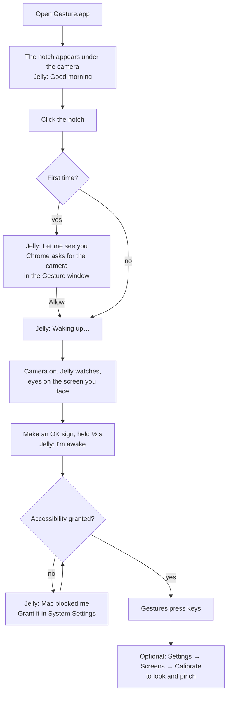
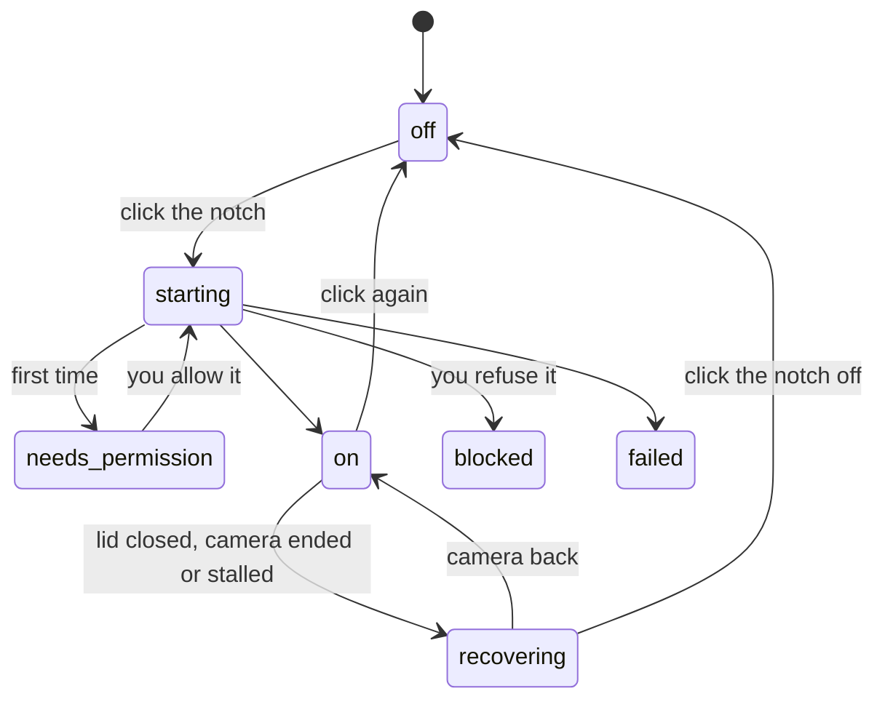
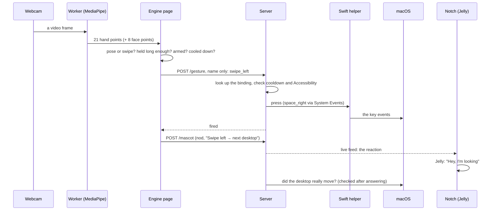
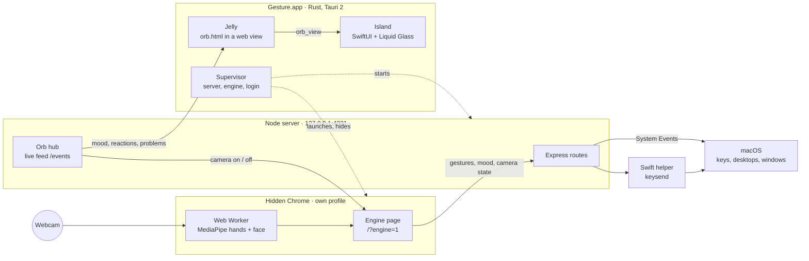

# Gesture

**Control your Mac with your hands, through the webcam you already have.**

Gesture watches your hand and your head through the laptop camera and turns
what it sees into actions on your Mac. Swipe to change desktops, look at a
screen and pinch to bring it forward, put a finger to your lips to mute Zoom,
make an OK sign to switch the whole thing on or off.

Its face is **Jelly**, a small glossy mascot that lives in a notch of Liquid
Glass at the top of your screen, right under the camera. Jelly shows what
Gesture sees and says what it just did, in a few words of its own.

Everything runs on your Mac. No camera frame ever leaves it.

> **Spatial input for the everyday desktop.** Gesture brings the look-and-pinch
> interaction of spatial computing to an ordinary Mac and its screens, with
> nothing but the webcam. It knows where your screens are around you and
> which one you are facing: in Simon Greenwold's words, the machine "retains
> and manipulates referents to real objects and spaces"
> ([MIT, 2003](https://en.wikipedia.org/wiki/Spatial_computing)). There is no
> headset and nothing in 3D: the output is the Mac you already use.


Fifteen seconds of it running. The **[full 71-second walkthrough](docs/gesture-film.mp4)**
has sound, and covers the four problems that shaped the architecture: why
detection had to move into a Web Worker, why macOS refuses a desktop switch it
didn't press, why one key-pressing library structurally *cannot* send one, and
how an open palm is told apart from a swipe that looks identical to it.

---

## Contents

1. [At a glance](#at-a-glance)
2. [How you use it](#how-you-use-it)
   - [First run](#first-run)
   - [Every day](#every-day)
   - [What Jelly shows and says](#what-jelly-shows-and-says)
   - [Sleep, wake and login](#sleep-wake-and-login)
   - [The Settings page](#the-settings-page)
3. [Gestures](#gestures)
   - [The set](#the-set)
   - [Spatial desk: look, then pinch](#spatial-desk-look-then-pinch)
   - [How to make a swipe](#how-to-make-a-swipe)
   - [Not every shortcut is equal](#not-every-shortcut-is-equal)
   - [Teach your own gestures](#teach-your-own-gestures)
   - [Measuring it: the check-up](#measuring-it-the-check-up)
   - [The Lab: snap and vanish](#the-lab-snap-and-vanish)
   - [Sound](#sound)
4. [How it works](#how-it-works)
   - [From hand to key](#from-hand-to-key)
   - [Detection](#detection)
   - [Recognition](#recognition)
   - [Deciding to act](#deciding-to-act)
   - [Pressing the key](#pressing-the-key)
   - [Knowing which screen you face](#knowing-which-screen-you-face)
   - [The orb's logic](#the-orbs-logic)
   - [The camera's life](#the-cameras-life)
   - [Safety](#safety)
5. [Architecture](#architecture)
   - [Three processes](#three-processes)
   - [Why detection runs in Chrome](#why-detection-runs-in-chrome)
   - [The desktop app](#the-desktop-app)
   - [Why the island is native](#why-the-island-is-native)
   - [The server's routes](#the-servers-routes)
   - [Always-on detection](#always-on-detection)
   - [Pressing keys on macOS](#pressing-keys-on-macos)
   - [What it costs the Mac](#what-it-costs-the-mac)
6. [Tech stack](#tech-stack)
7. [Install and run](#install-and-run)
8. [Configuration](#configuration)
9. [Project layout](#project-layout)
10. [Testing and tools](#testing-and-tools)
11. [Privacy and security](#privacy-and-security)
12. [Troubleshooting](#troubleshooting)
13. [Limits and what's next](#limits-and-whats-next)
14. [More documents](#more-documents)
15. [Research behind the choices](#research-behind-the-choices)

---

## At a glance

| | |
| --- | --- |
| **What** | Hand and head gestures, seen by the webcam, become actions on a Mac |
| **Input** | The built-in camera. 21 points on your hand, and your head's direction |
| **Output** | Keyboard shortcuts, media keys, desktop switches, window focus |
| **Face** | Jelly, in a Liquid Glass notch under the camera |
| **Runs on** | macOS (built on a MacBook Air M1, macOS 26). Liquid Glass needs macOS 26; the app runs from macOS 13 |
| **Privacy** | Fully on-device. Frames never leave the Mac |
| **Cost** | About 19% of one CPU core with the camera on and no hand in view ([measured](docs/PERFORMANCE.md)) |
| **Tests** | 286 JavaScript tests and 5 Rust tests, none of which need a camera |
| **State** | Working daily. The check-up with other people (Gate A) is next: see [Limits and what's next](#limits-and-whats-next) |

---

## How you use it

### First run



1. **Open the app.** The notch appears at the top centre of the built-in
   screen, under the camera, and Jelly says good morning (or afternoon, or
   evening).
2. **Click the notch** to turn the camera on. The first time, Chrome asks for
   the camera in the Gesture window, which the notch brings forward for you.
   After that the window stays hidden.
3. **Grant Accessibility** to Gesture in System Settings → Privacy & Security
   → Accessibility. macOS silently drops key presses from any app without it,
   so until then Jelly says "Mac blocked me".
4. **Arm it** with an OK sign held for half a second. Nothing presses a key
   until you do. Jelly winks and says "I'm awake".
5. **For look and pinch,** calibrate your screens once: right-click the notch
   → Settings → Screens → Calibrate. See [Spatial desk](#spatial-desk-look-then-pinch).

### Every day

- **It starts with your Mac** (Start at Login) and greets you when you log in
  and every time you open the lid.
- **Click the notch** to turn the camera on or off. With the camera off, Jelly
  covers its eyes: it isn't looking. After a restart the camera stays off
  until you click.
- **Make gestures.** Each one that works makes Jelly react and say a few
  words, for a moment. Each one that's refused gets a shrug and a reason.
- **OK sign again** to disarm when you want your hands back. Jelly goes to
  sleep.
- **Right-click the notch** for Settings, Start at Login and Quit.
- **Clicking it never takes focus** from the app you are typing in, and it
  shows on every desktop and over full-screen apps.

### What Jelly shows and says

At rest the notch is a small rectangle with Jelly in it. When there is
something to say, the notch grows sideways and the words appear beside Jelly,
then it shrinks back. It never grows down, so it covers as little as possible.

**Jelly's face, at rest:**

| Jelly | Means |
| --- | --- |
| Covering its eyes | Camera off. It isn't looking |
| Eyes open, smiling, breathing | Armed and ready |
| Eyes a little wider | A hand is in view |
| Eyes shut, "z z" | Disarmed: gestures paused |
| Looking down | You face no screen |
| Still, level mouth | The check-up is running. Nothing moves, so nothing can cue you |

Its eyes, and its whole face a little, turn toward the screen you are facing.

**What Jelly says** (`saidFor()` and `explainProblem()` in
[`public/orb/orb-state.js`](public/orb/orb-state.js)):

| When | Jelly says | Face |
| --- | --- | --- |
| You log in, or open the lid | Good morning / afternoon / evening | Waves |
| The camera is starting | Waking up… | Looks up, thinking |
| The camera prompt is waiting | Let me see you | Open eyes |
| You arm it | I'm awake | Winks, OK sign |
| You disarm it | Going to sleep | Eyes shut |
| A desktop swipe | Hey, I'm looking | Happy, a bounce |
| Swipe up / down | Down we go / Up we go | Happy |
| Pinch at a screen | Over there | Happy |
| Lock the screen | See you soon | Happy |
| Mute (shh) | Shh | Happy |
| Any other gesture | Got it | Happy |
| Camera turned off | I'm not looking | Covers its eyes |
| No face seen | I can't see you | A shrug |
| Mid-turn pinch | Hold still | A shrug |
| Facing no screen | Look at a screen | A shrug |
| Accessibility missing | Mac blocked me | A shrug |
| The desktop didn't move | That didn't work | A shrug |
| The camera is blocked | My camera is blocked | Worried, a bead of sweat |
| Something broke | Something broke | Worried |

**The detail,** such as which key went out or how to fix a problem, isn't
shown. VoiceOver reads it, along with Jelly's words. The same problem is said
once in 20 seconds, however often it happens.

**The light.** Jelly casts a warm glow into the glass, coloured by state:
- peach, normally;
- gold when a gesture works;
- amber for a warning;
- red for a problem.

It's dim with the camera off.

### Sleep, wake and login



- **Closing the lid** locks the screen, and about 15 seconds later Chrome
  suspends the camera. It can also end the camera outright.
- **When you open it again,** Jelly says "Waking up…" and the camera is tried
  again after 1, 2 and 4 seconds, then every 10 seconds, until it's back or
  you click the notch off.
- **On wake, Jelly greets you,** the same as at login.
- **At login, Gesture starts by itself.** An installed app rewrites its own
  login entry each time it starts, so moving or replacing the app can't leave
  it pointing at nothing.

### The Settings page

Right-click the notch → **Settings** brings forward the full page. It's the
same page that runs the camera, normally hidden.

- **Status bar,** across the top: camera, armed, which screen you face,
  whether keys can be pressed, and sound. Each is a word, not only a colour.
  Click **Armed** to toggle it. Click any other for the detail.
- **Sidebar:**
  - **Home:** what Gesture sees right now, in plain words, with a small camera
    preview and a setup checklist that ticks itself off.
  - **Gestures:** choose what each gesture does, from a list. Saved to
    `config.json` straight away.
  - **Screens:** the map of your displays, and calibration.
  - **Measure:** the check-up.
  - **Lab** (experimental): snap your fingers and turn to dust.
  - **Settings:** what `config.json` says, and whether Jelly shows in this
    page's header.
- **Diagnostics,** top right: the detector's raw readout (palm speed, swipe
  state, backend…) and the full activity log.

The page follows your Mac's light or dark appearance, and becomes tabs below
860 px wide. In a plain browser, <http://127.0.0.1:4321> is the same page.

---

## Gestures

### The set

The set is **locked**: picked on 24 Oct 2026, mostly from published gesture
studies, and adjusted by choice on 25 Oct after living with it.
`test/config.test.js` fails if a default changes without that test changing
too.

| Gesture | How | Does | Why this movement |
| --- | --- | --- | --- |
| **OK sign** | Thumb and index in a circle, other three up, **held ½ s** | Arm / disarm | "Yes" in a mid-air TV gesture study (Dim et al., *DIS '16*) |
| **Pinch** | **Look at a screen**, then thumb and index together | Bring that screen's front window forward | Look-then-pinch is how Vision Pro selects ([Apple](https://support.apple.com/en-asia/117741)) |
| **Swipe left / right** | Four fingers out, hand travels sideways | Next / previous desktop | Like a Mac trackpad |
| **Swipe up / down** | Four fingers out, hand travels up or down | Page down / up | Palm up / down for up / down (Dim et al., *DIS '16*) |
| **Shh** | Index finger upright on your lips, **0.4 s** | Mute the mic in Zoom (`cmd+shift+a`) | A candidate: common, but no study tests it for mute. It stays only if the check-up shows ≥ 90% success |
| **Fist** | All fingers curled | Lock the screen (`cmd+ctrl+q`) | Chosen live on 25 Oct. Caution: a thumbs-up reads as a fist |
| **Open palm** | All five out, **held still 1.2 s** | Play / pause music | Chosen live on 25 Oct |

**Built but not bound by default,** both pickable on the Gestures page if fist
or open palm misfire:
- **Close your hand:** an open palm, then a fist within 0.6 s. The studies'
  play / pause ("open / close palm", Dim et al., *DIS '16*). You only make it
  on purpose.
- **Cover the camera** for 1 s: "cover it" for pause or ignore (Dim & Ren,
  2014). It doesn't happen by accident.

**More actions are in the list:** camera on / off in Zoom (`cmd+shift+v`),
next / previous slide (`right` / `left`), next and previous track, volume,
Mission Control.

**Turn on Zoom's global shortcuts first.** In Zoom → Settings → Keyboard
Shortcuts, tick *Enable Global Shortcut* for **Mute/Unmute My Audio** and
**Start/Stop Video**. Without that, Zoom only hears them while it's in front.

**Guards:**
- **Shh** needs the face model to find your lips, so it only works with head
  tracking on. Head tracking turns on when shh is bound.
- **Swipe up / down** works exactly like the sideways swipe. Raising or
  lowering an open hand quickly will scroll, so curl your fingers when your
  hand comes into view or leaves it. Every up / down movement that doesn't
  scroll says why, in Diagnostics → Up / down swipe.

**What changed from v1:**
- Point is gone; it fired nothing in its first live test.
- The OK sign took over arming from pinch, which now focuses a screen.

**Caveats:**
- The two Dim studies had blind participants. Their consensus sets were the
  ones that could be read in full.
- A Leap Motion TV study found low agreement between people for finger
  gestures (Vatavu & Zaiti, *TVX '14*). No set is "natural" for everyone,
  which is what the check-up measures.

### Spatial desk: look, then pinch

Every other gesture does the same thing wherever you look. This one doesn't.
The camera also tracks which way your head is turned, so **the hand says
*what* and the head says *where*.**

- **Look at a screen and pinch:** the front window on that screen comes
  forward, and the pointer jumps onto it.
- **It goes by where you looked while pinching,** not where your head is the
  moment the pinch completes. Turn and pinch as you arrive, and it lands on
  the new screen. Pinch mid-turn, and Jelly says "Hold still" rather than
  guessing.
- **Looking at neither,** at your notebook say: pinching does nothing, and
  Jelly says "Look at a screen". It never guesses the nearest screen.
- **A refused pinch costs no wait.** Let go and pinch again straight away.

**Set it up once.** It needs the native helper (`npm run build:native`).
1. Start the camera.
2. Press **Calibrate** under **Screens**.
3. The page asks for each screen in turn, left to right, with a countdown and
   a tick. Look at the middle of that screen and hold still until the next
   one is called: about two seconds per screen.
4. Calibrate again if you move your monitors or your chair.

**What you see.**
- **The Screens map** shows your displays as macOS arranges them, with the one
  you face lit green.
- **The Head and Facing rows** show your head's angles next to the
  20° limit.
- **Clicking a screen** on the map does the same as looking at it and
  pinching, so the window side can be tested without the camera.

**Why the head and not the eyes.** A laptop webcam can't tell where your
pupils point to better than a few degrees. Monitors sit tens of degrees apart,
and you turn your head, not just your eyes, to look at one that far away.
Head direction is the coarse, reliable signal that fits the question.

**Notes:**
- **Calibration stays in this browser,** tied to this desk and this chair.
- **Head tracking only loads when something needs it** (pinch or shh bound).
- **The server checks the screen:** it refuses a display that isn't connected.
- **Moving windows between screens was removed** in v2. Nothing showed it was
  needed; it's in git history.

### How to make a swipe

The swipe is the fussiest gesture, because it's a *motion* while the others
are *poses*.

1. **Four fingers out.** The thumb is ignored.
2. **Move your whole hand, briskly.** Your palm needs to travel about **1.2
   palm-widths** (roughly 10–12 cm) within **350 ms**. A flick, not a drift: a
   slow, careful sweep registers as nothing at all.
3. **Keep it straight.** Movement across must stay under half the movement
   along, so a diagonal wave is rejected.
4. **Curl your fingers afterwards** to re-arm before the next swipe.

Watch **Palm speed** in Diagnostics while you try: it shows your speed next
to the threshold.

**Direction** is the way your hand travels, matching the mirrored preview.
The defaults are trackpad-like: you push the current desktop out of the way,
so travelling left brings in the next one from the right. Swap the two values
in `config.json` if that feels backwards.

**Why the open palm and the swipe fight each other.** The swipe pose, four
fingers out, is a subset of the open palm. Every phase of a swipe collides
with it, and each needs its own guard:

| Phase | Problem | Guard |
| --- | --- | --- |
| **Before** | Getting into position means holding an open palm | Open palm needs a deliberate **1.2 s** hold |
| **During** | The moving hand still matches open palm | Poses are ignored above a palm speed of 0.8 palm-widths a second |
| **After** | The swipe *ends* in the open-palm shape | Poses are suppressed until the shape changes |

Miss any one, and a swipe plays your music.

### Not every shortcut is equal

The server presses keys. **Something has to be listening.** Bindings fall
into three kinds, and only the first works with no setup:

1. **macOS built-ins:** `cmd+ctrl+q` (lock screen) and `ctrl+up` (Mission
   Control). System-wide, always listening.
   - **Desktop switching is the exception.** `ctrl+←` and `ctrl+→` work from
     your keyboard but not from a key this process makes. That's why the
     swipes use the `space_left` and `space_right` actions instead. See
     [Pressing keys on macOS](#pressing-keys-on-macos).
2. **Media keys** (`audio_play`, `audio_mute`, `audio_next`, `audio_vol_up`…)
   go to whatever owns playback, whatever is in front. That's why open palm
   uses `audio_play` rather than `space`: `space` goes to the front app, which
   is rarely the music app.
3. **App shortcuts** need that app to be listening, and most only listen while
   in front. macOS has **no** global mic-mute shortcut, so shh relies on
   Zoom's own global one (`cmd+shift+a`). Teams' `cmd+shift+m` only works
   while Teams is in front.

A bare `escape` is refused at load: it's the page's panic disarm.

If a gesture shows `-> shortcut` in the Activity log but nothing happens,
detection worked and the *binding* has no listener. Look at this list, not at
your hand.

### Teach your own gestures

On the Gestures page, under **Your gestures**:
1. Type a name (lowercase, like `peace`).
2. Press **Record**, and hold a new hand shape in view. After a countdown, the
   page keeps five samples of it.
3. Pick what it does in its new row.

It's saved like any other gesture, with a `custom:` prefix:

```json
"gestures": { "custom:peace": "audio_next" }
```

- **Matching** is nearest-neighbour over the 21 landmarks, measured in palm
  lengths and forgiving up to 30° of tilt. The **Taught match** row shows the
  closest one and how close.
- **Same rules as the built-in set:** arming, cooldown, and a 400 ms hold.
- **Refused on purpose:**
  - shapes that are already a built-in gesture;
  - shapes too close to one you've taught;
  - four fingers out, which is how every swipe starts.
- **The page can only choose from a list of safe actions.** Any other
  shortcut has to be typed into `config.json` by hand, so the page can never
  make a gesture press an arbitrary key.
- **Samples stay in this browser.** Nothing is sent anywhere.

### Measuring it: the check-up

The first version was designed without measurements, and in its first real
session it fired nothing in 80 seconds. So nothing changes now until the
**check-up** says what to change.

Under **Measure**, type a participant code (`p1`, `p2`…) and press **Run
check-up**. It's about four minutes of spoken prompts. After each prompt, a
short wait, then a chime. React to the chime, not the words.

- **Facing:** "look at laptop", "look at BenQ", and a few "look at your
  keyboard". It records which screen the tracker picked a second after the
  chime, how long it took to settle, and how steady your head reading is.
- **Gestures:** six of each one bound. It records whether each was seen and
  how fast, and for a miss, what the camera took the hand for instead.

Nothing fires while it runs: every gesture is a measurement, not a command.
Results are compared with **proposed** pass marks (Gate A):
- the right screen ≥ 95% of the time;
- "away" read as no screen ≥ 80%;
- each gesture ≥ 90%;
- pinch within 800 ms.

Every trial is appended to `experiments/<date>.jsonl` on this Mac
(gitignored), including the raw head angles, so other smoothing settings can be
tried on the same heads afterwards:

```bash
node scripts/replay-facing.mjs
```

### The Lab: snap and vanish

An experiment on its own page. Snap your fingers and you turn to dust, like
the film. The room shows through where you were, even while you move. Snap
again, or wait 10 seconds, and the dust flies back into the pose you're in.

- **Nothing fires in the Lab.** A snap's set pose is close to a pinch.
- **The room:** Gesture learns the room behind you as you move, never you.
  **Room seen** says how much it knows, and **Capture the room** talks you
  through leaning left and right so it can see behind you.
- **The look:** sliders for duration, drift, speed, speck size and ash.
- **Record** saves a clip of the stage (MP4 in Chrome).
- **Snap practice** measures the snap: ten prompted snaps, then 20 seconds of
  moving without snapping, saved to `experiments/` for
  `node scripts/replay-snaps.mjs`.

**How the snap is seen.** A snap is over in about 7 ms (Acharya et al., *J. R.
Soc. Interface*, 2021); the camera takes a frame every 33 ms. So the camera
never sees the snap itself. It sees the *set*, the thumb pressed on the middle
fingertip, and on the very next frame the finger already in the palm. That
pair is the snap.

The person cutout is MediaPipe's selfie segmenter (about 7 ms a frame on an
M1), and the effect is WebGL2. The snap's thresholds are starting guesses
until snap practice has been run and replayed.

### Sound

A short rising sound when a gesture lands, a low falling one when it doesn't,
and a tick for a dry run. A desktop switch that macOS ignored sounds like a
failure, because the server checks. The desktop app starts its hidden page
with Chrome's sound rule lifted, so cues play from the start. Turn them off
with `"feedbackSound": false`.

---

## How it works

### From hand to key



The page sends only the gesture's **name**. The server alone knows what that
name presses.

### Detection

[`public/detector-worker.js`](public/detector-worker.js), in a Web Worker
inside the hidden Chrome page:

- **The camera** runs at 640 × 360, 30 frames a second. MediaPipe shrinks every
  frame to 192–256 px before its models see it, so more pixels buy nothing.
  The Lab asks for 1280 × 720 while it's open, for sharp recordings.
- **Frames** come straight off the camera track with `MediaStreamTrackProcessor`.
  The track is cloned for the worker, because a processor consumes the track
  it's given.
- **The hand model** (MediaPipe Hand Landmarker) finds 21 points on your hand.
- **The face model** (MediaPipe Face Landmarker) runs on every other frame,
  only when head tracking is needed. Only the 8 points used are sent on: eye
  corners, forehead, chin and lips.
- **Slow when idle:** with no hand for 1 second, a frame is checked only every
  125 ms, about 8 a second. The first frame with a hand puts it back to full
  rate. Calibration, the check-up, teaching and the Lab always run at full
  rate.
- **Lens brightness** (for "cover the camera") is only measured while cover is
  bound or a check-up runs.

### Recognition

The page turns points into gestures. Each part is a pure module with its own
tests:

| Module | Decides |
| --- | --- |
| [`gestures.js`](public/gestures.js) | Which **pose** a hand is in (OK sign, pinch, fist, open palm, shh…), from finger geometry in palm lengths, so it holds at any distance and tilt |
| [`swipe.js`](public/swipe.js) | Whether the hand made a **swipe**: travel, speed and straightness over the last 350 ms |
| [`transitions.js`](public/transitions.js) | **Close your hand:** an open palm becoming a fist within 0.6 s |
| [`cover.js`](public/cover.js) | **Cover the camera:** the picture dark and flat for 1 s, compared with the last 5 s, so a dim room doesn't count |
| [`custom-gestures.js`](public/custom-gestures.js) | Which **taught** gesture is nearest, if any is near enough |
| [`recognizer.js`](public/recognizer.js) | When a pose has **been held** long enough to count, and when it may count again |

**The recognizer's rules:**
- **A pose must be held:** 180 ms by default, ½ s for the OK sign, 0.4 s for
  shh, 1.2 s for an open palm, 0.4 s for taught gestures.
- **Change shape before the same one fires again.**
- **A moving hand isn't a pose:** poses are ignored above a palm speed of 0.8
  palm-widths a second.
- **A flicker isn't a release:** a break under 150 ms doesn't end the hold, so
  a flickering OK sign fires once.
- **The same gesture waits 1.2 s** before it can fire again.

### Deciding to act

`onGestureDetected()` in [`public/app.js`](public/app.js), for every gesture
recognised:

1. **Not bound to anything?** Ignore it.
2. **An action the page does itself** (arm / disarm)? Do it here, armed or not,
   since it's the way back from disarmed.
3. **Not armed?** Ignore it.
4. **An action on a screen** (pinch)? Pick the screen you faced during the
   pinch, and send it with the display's id.
5. **Otherwise:** `POST /gesture` with the name.

Every outcome is a reaction for Jelly: a nod for "fired", a shrug for
"refused", numbered so the notch shows each one once.

### Pressing the key

`POST /gesture` in [`server/index.js`](server/index.js):

1. **Same-origin only,** at most 4 kB of JSON.
2. **Look up the binding** in `config.json`. An unbound name is refused.
3. **Cooldown, again, on the server,** on a clock that only moves forward, so a
   duplicated tab or a reload can't repeat a press.
4. **Dry run?** Log it, press nothing.
5. **Accessibility,** checked on every press, since it can be revoked while the
   server runs. Without it, the answer says so rather than claiming the key
   fired.
6. **Press** through the chosen backend (see
   [Pressing keys on macOS](#pressing-keys-on-macos)).
7. **Answer at once.** For a desktop switch, it then watches the desktop for 2
   seconds. If macOS didn't move it, or moved it back, it says so through the
   notch's live feed.

### Knowing which screen you face

[`public/screens.js`](public/screens.js):

1. **Head angles:** yaw and pitch from 8 face points.
2. **Smoothed** with an exponential moving average. A 1€ filter is built and
   waiting on the check-up's data to be chosen.
3. **Nearest calibrated screen within 20°.** A screen must beat the current
   one by 4° before attention moves, so a head half-way doesn't flicker.
4. **A pinch uses the screen faced for most of its own hold.** If you were
   still turning, it refuses.
5. **The server** gets the display id, checks it's connected, brings that
   display's front window forward with the native helper, and moves the
   pointer onto it.

### The orb's logic

The notch's page ([`public/orb/orb.js`](public/orb/orb.js)) listens to the
server's live feed (`GET /events`). On every change it asks
[`orb-state.js`](public/orb/orb-state.js), which is pure and tested, what to
show. The first matching row wins:

| Priority | Situation | Shows for |
| --- | --- | --- |
| 1 | The server unreachable for 3 s | Until it's back |
| 2 | The camera prompt waiting | Until answered |
| 3 | Camera blocked or failed | 4 s |
| 4 | A gesture refused | 4 s |
| 5 | A gesture fired | 1.5 s |
| 6 | You turned the camera off | 1.5 s |
| 7 | The camera starting, or coming back | Until on |
| 8 | A greeting, at login and on wake | 4 s |
| 9 | Otherwise: at rest, Jelly's face only | |

- **Wake is noticed without any system hook:** a timer gap over 60 seconds
  means the Mac slept, so it greets you.
- **The page redraws only on events,** plus one timer for the moment a message
  runs out, never on an interval.
- **Jelly's mood** comes from the engine page ([`ui/mascot.js`](public/ui/mascot.js)),
  sent to the server on every change and every 2 seconds while alive. A page
  silent for 5 seconds reads as offline.

### The camera's life

- **The notch asks:** a click sends `POST /camera {on}`, and the server relays
  it to the hidden page over its live feed.
- **The page does it, and reports back** what actually happened (starting,
  needs permission, on, off, blocked, failed), so the notch says what is
  true, not what was asked.
- **Watchdogs:**
  - a camera with no frames for 3 seconds, or one the system ended, is
    restarted;
  - in the desktop app, it keeps retrying (1, 2, 4, then every 10 seconds)
    for as long as the camera is wanted, so a Mac that wakes with the screen
    still locked recovers once you unlock;
  - while the screen is locked, Chrome's own pause is left alone.

### Safety

- **Armed or not:** nothing presses a key until you arm it. <kbd>Esc</kbd> on
  the page disarms.
- **Names, not keys:** the page sends `{"gesture": "fist"}` and the server
  decides the shortcut. A compromised page can only trigger what you already
  bound.
- **Localhost only, same-origin only:** without the origin check, any website
  open in your browser could post to this port and lock your screen.
- **The page can only pick from a list of safe actions.** Arbitrary shortcuts
  have to be typed into `config.json` by hand.
- **Quiet while measuring:** nothing fires during the check-up or in the Lab.

---

## Architecture

### Three processes



| Process | Language | Does |
| --- | --- | --- |
| **The desktop app** | Rust (Tauri 2), Swift (SwiftUI) | Draws the notch and Jelly; starts and supervises the server and the engine; Start at Login; the right-click menu |
| **The engine** | JavaScript in Chrome | The camera, detection and recognition, in a Chrome of its own, kept hidden. It's also the Settings page |
| **The server** | Node.js (Express) | Presses keys, switches desktops, focuses windows; holds the config; streams the live feed to the notch and the engine |

The server and the engine also run on their own with `npm start` and a browser
tab. The desktop app is what turns them into something that lives on your Mac.

### Why detection runs in Chrome

Only one of the two engines can detect while its window isn't visible. The
page reports which it is at load:

| Engine | `MediaStreamTrackProcessor` | Detection path | Works hidden |
| --- | --- | --- | --- |
| Chrome | **yes** | Worker fed by `MediaStreamTrackProcessor` | **yes** |
| Tauri's WKWebView | **no** | `requestVideoFrameCallback` on the main thread | no |

WebKit freezes `requestVideoFrameCallback` for any page that isn't visible,
and turning off its background throttling keeps the page scheduled but
doesn't bring the frames back (measured). Rebuilding camera capture and
inference natively would mean reaching a place Chrome already occupies. So
the notch is native, and detection stays in Chrome.

### The desktop app

[`src-tauri/src/lib.rs`](src-tauri/src/lib.rs):

- **The server:** starts `node server/index.js`, or attaches to one already on
  the port, so `npm start` and the app stay interchangeable. It finds Node
  where people install it, because an app opened from Finder or at login gets
  a bare `PATH`.
- **Finding the project,** in this order:
  1. `GESTURE_ROOT`;
  2. the app bundle's resources;
  3. the folders above the app;
  4. the folder the app was built from, which lets a copy in `/Applications`
     run.
- **The engine:** launches Chrome with a profile of its own (in
  `~/Library/Application Support/Gesture/Engine`) at `/?engine=1`, hides it,
  relaunches it if it dies, and quits it with the app.
- **No orphans:** the server watches the app's process and exits if the app is
  force-quit, so nothing is left holding port 4321.
- **The notch panel:** a non-activating `NSPanel` (tauri-nspanel) at the
  status-bar level, on every desktop and over full-screen apps, at the top
  centre of the built-in display.
- **Still while you switch desktops:** joining all desktops isn't enough,
  since a window is still drawn into each desktop's picture and slides with
  it. The panel is moved onto a private WindowServer space above all desktops,
  as notch apps do. **Private API:** looked up at run time, so if macOS
  removes it the notch still shows and just slides. `GESTURE_NO_PIN=1` turns
  it off.
- **Start at Login:** a LaunchAgent. An installed app rewrites it with its own
  path each time it starts.

### Why the island is native

The first notch had the web page draw the words and Jelly, while a native
glass view was moved along behind it, and the window resized at every open
and close. It felt laggy and stiff. Four causes, all measured or documented:
- **Two clocks:** two animations in two processes drift apart.
- **Stale frames:** a resized web view shows stretched content until it
  redraws ([Apple forums](https://developer.apple.com/forums/thread/802660)).
- **Relayout:** `width` and `height` transitions relayout every frame
  ([web.dev](https://web.dev/articles/animations-and-performance)).
- **No momentum:** a fixed curve loses its speed when interrupted.

Now the island is one SwiftUI view, in
[`src-tauri/island/Sources/Island/Island.swift`](src-tauri/island/Sources/Island/Island.swift):

- **Liquid Glass** (`glassEffect`, the clear kind) in a notch shape that
  flares into the top edge, with the content in the glass, as Apple asks
  ([WWDC25](https://developer.apple.com/videos/play/wwdc2025/310/)).
- **Springs** that keep their speed when a new message interrupts them
  ([WWDC23](https://developer.apple.com/videos/play/wwdc2023/10158/)). Opening
  has a little give (response 0.42, damping 0.8) and closing doesn't bounce
  (0.45, 1.0). These are boring.notch's values.
- **A panel that is never resized** (400 × 48 pt). The notch opens and closes
  inside it, and the panel lets clicks through everywhere but the notch, by
  watching the pointer.
- **Jelly stays its web page,** one art file shared with the Settings header,
  in a fixed 32 pt box. The notch's width animates through a SwiftUI modifier
  that also places Jelly's box on every frame, so Jelly and the glass move as
  one.
- **Built into the app** with swift-rs's `SwiftLinker`, which Tauri already
  depends on.

### The server's routes

All on `127.0.0.1:4321`. Every request that changes something is same-origin
only.

| Route | For |
| --- | --- |
| `GET /` | The page: Settings, and the hidden engine at `/?engine=1` |
| `GET /orb.html` | Jelly, for the notch |
| `POST /gesture` | A gesture's name; presses its binding |
| `GET /config` | The current config, as the page needs it |
| `POST /config/gestures` | Change a binding from the list, written to `config.json` atomically |
| `GET /screens` | The connected displays |
| `GET /events` | The live feed: mood, camera, engines, config changes, problems |
| `GET /orb` | The same state as one snapshot |
| `POST /mascot` | The page's current mood and last reaction |
| `POST /camera` | The notch's click: camera on or off |
| `POST /camera/state` | What the camera actually did |
| `POST /heartbeat`, `POST /client`, `GET /recent` | Health: frame rate, engine, recent events |
| `POST /experiment` | A check-up or snap-practice record, appended locally |
| `GET /health` | Backend, Accessibility, and which app needs it |

### Always-on detection

The app drives *other* apps, so its own window is almost never the visible
one, and browsers suspend hidden pages. Measured with the tab hidden:

| Loop | Frames a second while hidden |
| --- | --- |
| `requestAnimationFrame` | 0 |
| `requestVideoFrameCallback` | 0 |
| `setInterval` | 1.5 |
| `setInterval` while playing audio | 1.5 |
| **`setInterval` inside a Web Worker** | **62.5** |

"Play silent audio to keep the tab awake" does nothing. Only workers escape
the throttle, and the camera itself never stops, so the frames are there to be
read. Two traps:
- **A classic worker, not a module worker:** MediaPipe's WASM fails with
  `ModuleFactory not set.` in a module worker.
- **Timestamps are taken on the page,** because a worker's `performance.now()`
  runs on a different clock.

### Pressing keys on macOS

**Three backends,** tried in this order under `"backend": "auto"`:

| Backend | Needs | Can switch desktops | Media keys |
| --- | --- | --- | --- |
| `cgevent`: the Swift helper ([`native/keysend.swift`](native/keysend.swift)) | `npm run build:native` | **yes** | yes |
| `nutjs`: `@nut-tree-fork/nut-js` | nothing | **no** | yes |
| `osascript`: System Events | nothing | no | no |

**Why nut.js can't switch desktops.** Its native module sets the modifier as a
*flag* on the key event and never sends a separate modifier event. macOS
matches system hotkeys, such as *Move left a space*, against the
WindowServer's global modifier state, which only those modifier events
update. So the app in front sees a real `Ctrl+→`, and the desktop never
moves. The Swift helper posts the modifier events around the key, exactly as
a keyboard does.

**Why desktops don't respond even to that.** On macOS 26, a `Ctrl+→` that this
process makes will not switch desktops, from either backend. Measured with
`npm run probe:keysend`:

| Method | Result |
| --- | --- |
| nut.js, both ways | never moves |
| Swift helper, real modifier events, all four event-source tables | never moves |
| **System Events (`osascript`)** | **moves, and stays** |
| `CGSManagedDisplaySetCurrentSpace` (private) | moves; can snap back |
| The trackpad's dock-swipe gesture (private fields) | moves; snapped back in 2 of 4 setups |

The key *is* delivered to the app in front; the WindowServer just declines to
treat it as the desktop hotkey. So `space_left` and `space_right` go through
System Events (`"spaceStrategy": "osascript"`, the default), which uses no
private API. It needs Accessibility and Automation permission for whichever
app runs the server.

**Every desktop switch is checked.** With `verifySpaceSwitch` on, the server
reads the current desktop before and after:

```
swipe_left -> space_right  (space main 2/4 -> main 3/4)
```

and when it didn't move, it says so, in the terminal and through Jelly:

```
swipe_left -> space_right
  !! sent, but the desktop did not move — still on main 2/4.
```

That separates *the key was never sent* from *the key was sent and macOS
ignored it*: the two halves this bug kept blurring.
[ARCHITECTURE.md](ARCHITECTURE.md) has the dock-swipe event fields and the
event-source tables.

### What it costs the Mac

Measured with `node scripts/measure-load.mjs 60`: camera on, page hidden, no
hand in view, on a MacBook Air M1, before and after the clean-up pass of 25
Oct 2026 ([details](docs/PERFORMANCE.md)):

| Process | Before | After |
| --- | ---: | ---: |
| Chrome GPU process (the models and the video) | 39.1 | 7.2 |
| Chrome renderer (the hidden page) | 15.1 | 5.9 |
| Chrome camera capture | 3.0 | 4.7 |
| Chrome itself | 1.0 | 0.5 |
| The desktop app | 1.2 | 0.3 |
| The notch's WebKit | 1.4 | 0.3 |
| The Node server | 0.4 | 0.3 |
| **Total, % of one core** | **61.1** | **19.3** |

What did most of it:
- **Pacing:** checking every 125 ms when no hand is in view.
- **A smaller camera picture:** 640 × 360.
- **Fewer face points sent:** 8 instead of 478.
- **Nothing drawn while hidden.**
- **No polling:** a live feed instead.

With the camera off, Jelly is completely still, so the notch costs nothing to
show.

---

## Tech stack

| Layer | Technology | Why |
| --- | --- | --- |
| Hand and face tracking | [MediaPipe Tasks Vision](https://ai.google.dev/edge/mediapipe/solutions/vision/hand_landmarker) 1.0.1: Hand Landmarker, Face Landmarker; Image Segmenter for the Lab | 21 hand points and a face mesh in real time, on-device, maintained |
| Detection loop | Web Worker + `MediaStreamTrackProcessor`, in Chrome | The only setup measured to keep detecting while hidden |
| Page and Settings | Plain ES modules, HTML and CSS, no framework | Small, readable, nothing to build; the logic lives in pure, tested modules |
| Lab effect | WebGL2 | The dust and the room, at camera rate |
| Server | Node.js ≥ 22, Express 5 | Small local HTTP server and a live feed (Server-Sent Events) |
| Key presses | A Swift helper (CGEvent), [`@nut-tree-fork/nut-js`](https://www.npmjs.com/package/@nut-tree-fork/nut-js), AppleScript System Events | Each covers what the others can't; see [Pressing keys](#pressing-keys-on-macos) |
| Desktop app | [Tauri 2](https://tauri.app) (Rust), [tauri-nspanel](https://github.com/ahkohd/tauri-nspanel), tauri-plugin-autostart, objc2 AppKit bindings | A light native shell: the panel, supervision, login |
| The notch | SwiftUI, Liquid Glass (`glassEffect`, macOS 26), linked with [swift-rs](https://github.com/Brendonovich/swift-rs) | Apple's own glass and springs, in one animation |
| Pinning | SkyLight (private), looked up at run time | Keeps the notch still while desktops slide |
| Jelly | One SVG and CSS, shared by the notch and the Settings header | One art file; moods are CSS, breathing runs on the GPU |
| Tests | `node:test` (286), `cargo test` (5) | No camera needed: hands are generated geometrically |

**On two dependency choices:**
- **`@nut-tree-fork/nut-js` rather than `@nut-tree/nut-js`:** the original was
  pulled from npm and its binaries moved behind a subscription. The fork is
  Apache-2.0 and maintained.
- **`@mediapipe/tasks-vision` rather than `@mediapipe/hands`:** the old Hands
  package was last published in 2023. Same 21 landmarks, maintained package.

---

## Install and run

### Requirements

- **macOS.** The browser half is cross-platform, but pressing keys is
  macOS-only.
- **Node 22 or newer** (developed on 26.4).
- **Google Chrome,** for the camera page.
- **Apple's Command Line Tools,** for the Swift helper and the notch
  (`xcode-select --install`).
- **A Rust toolchain** for the desktop app (<https://rustup.rs>).

### Just the page, in a browser

```bash
npm install
```

```bash
npm run build:native
```

```bash
npm start
```

Then open <http://127.0.0.1:4321>. The setup checklist on Home walks you
through allowing key presses, starting the camera, calibrating and arming.

`build:native` compiles the ~800-line Swift helper. Without it, desktop
switching and look-and-pinch don't work; everything else does.

To keep MediaPipe's code and models on this Mac instead of a CDN (about
30 MB, gitignored):

```bash
npm run fetch-model
```

This is worth more than offline use: the worker that holds raw camera frames
loads MediaPipe with `importScripts`, which can't check an integrity hash, so
a CDN copy means third-party code in the one place with your camera.

### The desktop app

```bash
npm run app:dev
```

That runs it from source. To install it so it starts with your Mac:

```bash
npm run app:build
```

```bash
cp -R src-tauri/target/release/bundle/macos/Gesture.app /Applications/
```

Open `/Applications/Gesture.app` once, and turn on **Start at Login** from the
notch's right-click menu.

- **Build it from the folder you keep:** the installed app runs its server
  from the folder it was built in.
- **Quit it before `npm run app:dev`,** or there will be two notches.

### Permissions

- **Accessibility, for key presses.** System Settings → Privacy & Security →
  Accessibility → Gesture. The grant follows whatever started the server:
  - Gesture, for the installed app;
  - your terminal, for `npm run app:dev` or `npm start`.

  `GET /health` names the app to enable.
- **Every rebuild needs the grant again.** An unsigned app's permission is tied
  to that exact build, and macOS treats each rebuild as a new app. If Gesture
  is ticked and access is still denied, remove it with **−** and add it again.
- **The camera** is Chrome's, asked once in the Gesture window.
- **Automation** (System Events), for desktop switching, asked the first time.
  `Info.plist` declares why, which is what lets the prompt appear.

---

## Configuration

Everything about gestures lives in [`config.json`](config.json). The server
reloads it on save: no restart and no code changes. A mistake is reported with
the gesture's name, and the previous config stays live.

```json
{
  "gestures": {
    "ok_sign": "toggle_armed",
    "pinch": "focus_screen",
    "swipe_left": "space_right",
    "swipe_right": "space_left",
    "shh": "cmd+shift+a",
    "swipe_up": "pagedown",
    "swipe_down": "pageup",
    "fist": "cmd+ctrl+q",
    "open_palm": "audio_play"
  },
  "holdMs": { "default": 180, "open_palm": 1200, "ok_sign": 500, "shh": 400 },
  "cooldownMs": 1200,
  "requireReleaseBetweenFires": true,
  "stillnessMaxVelocity": 0.8,
  "swipeWindowMs": 350,
  "swipeMinTravel": 1.2,
  "swipeMinVelocity": 3,
  "swipeMaxVerticalRatio": 0.5,
  "swipeRearmRequiresPoseBreak": true,
  "invertSwipeDirection": false,
  "backend": "auto",
  "keysendSource": "hid",
  "spaceStrategy": "osascript",
  "verifySpaceSwitch": true,
  "screenMaxAngle": 20,
  "screenMovesPointer": true,
  "dryRun": false,
  "port": 4321
}
```

### Shortcut syntax

Modifiers `cmd`, `ctrl`, `alt` and `shift` (and the aliases `command`,
`meta`, `super`, `control`, `opt`, `option`), joined with `+`, ending in a key:

- letters `a`–`z`, digits `0`–`9`;
- `space` `enter` `tab` `escape` `up` `down` `left` `right` `delete`
  `backspace` `home` `end` `pageup` `pagedown` `f1`–`f12`;
- punctuation: `minus` `equal` `comma` `period` `slash` `semicolon` `quote`
  `backslash` `backtick` `leftbracket` `rightbracket`;
- media: `audio_play` `audio_mute` `audio_next` `audio_prev` `audio_vol_up`
  `audio_vol_down`. These need the `cgevent` or `nutjs` backend.

**Actions, not keys:** `toggle_armed`, `focus_screen`, `space_left`,
`space_right`. A modifier on an action, like `cmd+space_right`, is refused.

### Tuning

Speeds and distances are in **palm-widths** (wrist to middle knuckle), so
they hold at any distance from the camera.

| Setting | Meaning |
| --- | --- |
| `cooldownMs` | Minimum gap between two fires of the same gesture |
| `holdMs` | How long a pose must be held: one number for all, or per gesture, with `"custom"` for taught gestures. Swipes ignore it |
| `requireReleaseBetweenFires` | Change shape before the same one fires again |
| `stillnessMaxVelocity` | Above this palm speed, poses are ignored |
| `swipeWindowMs` | How far back a swipe's travel is measured |
| `swipeMinTravel` | Distance a swipe needs, in palm-widths |
| `swipeMinVelocity` | Speed floor, in palm-widths a second |
| `swipeMaxVerticalRatio` | How diagonal a swipe may be |
| `swipeRearmRequiresPoseBreak` | Curl your fingers between swipes |
| `invertSwipeDirection` | Flip left and right, for already-mirrored cameras |
| `backend` | `auto`, `cgevent`, `nutjs`, `osascript` or `dryrun` |
| `keysendSource` | Which event-source table the Swift helper posts from: `hid` (what a real keyboard uses), `combined`, `private` or `null` |
| `spaceStrategy` | How desktop switches are made: `osascript` (default, no private API), `direct` or `dockswipe` |
| `dockSwipeVariant`, `dockSwipeVelocity`, `dockSwipeLingerMs`, `dockSwipeWithTap` | Only for `dockswipe`: see [ARCHITECTURE.md](ARCHITECTURE.md) |
| `verifySpaceSwitch` | Check that a desktop switch really happened, and say when it didn't |
| `screenMaxAngle` | How far your head may turn from a screen and still face it, in degrees |
| `screenMovesPointer` | Move the pointer onto the window a pinch brings forward |
| `customMaxDistance` | How close a hand must be to a taught gesture to match, in palm lengths (0.18) |
| `feedbackSound` | Sound cues on or off |
| `dryRun` | Recognise and log gestures, press nothing |

---

## Project layout

```
config.json              bindings and tuning: the only file most people touch
public/                  the page, the engine and Jelly
  app.js                 camera, the detection loop, the decisions, the page's I/O
  detector-worker.js     MediaPipe in a Web Worker, paced down when no hand is in view
  worker-lib.js          the worker's pure helpers: pacing, brightness
  gestures.js            poses (pure)
  swipe.js               swipes (stateful)
  transitions.js         close your hand
  cover.js               cover the camera
  recognizer.js          holds, cooldowns, releases: when a pose counts
  custom-gestures.js     taught gestures: samples, nearest-neighbour matching
  screens.js             head direction to the screen you face
  checkup.js, stats.js   the check-up, and its statistics
  snap.js                the finger snap, and snap practice
  feedback.js            sound cues and spoken prompts
  ui/                    status, setup checklist, plain words, views;
                         Jelly: mascot.svg (the art), mascot.css (its moods),
                         mascot.js (which mood), mascot-view.js (blinks, gaze)
  lab/                   the vanish effect: person cutout, room, WebGL, timeline
  orb.html, orb/         Jelly for the notch: orb-state.js decides, orb.js does I/O
server/
  index.js               Express: the routes, the gesture pipeline
  config.js              load, validate, hot-reload config.json
  shortcut.js            "cmd+shift+m" to keys
  backends/              cgevent, nutjs, osascript, and the order they're tried
  macos.js               desktops, system hotkeys, which app needs permission
  screens.js             displays, and focusing the front window on one
  orb-hub.js             the live feed: mood, camera, engines, problems
  experiments.js         check-up records, appended to experiments/<date>.jsonl
  permissions.js         the Accessibility check
native/keysend.swift     the Swift helper: keys, desktops, windows, displays
src-tauri/               the desktop app
  src/lib.rs             the panel, the server, the engine, login
  island/                the notch, in SwiftUI
  capabilities/orb.json  what the notch's page may call
scripts/                 build, model fetch, probes, replays, load measurement
test/                    node:test: 286 tests, no camera needed
docs/                    the case study, Jelly, performance, roadmap
```

---

## Testing and tools

```bash
npm test
```

286 tests cover where the real logic lives:
- poses and swipes;
- holds and cooldowns;
- taught gestures;
- head direction to screen;
- the check-up's plan and scoring;
- the snap;
- the notch's picture and Jelly's words and moods;
- the server's config, feed and records.

Hands are generated geometrically rather than recorded, so cases like *a fist
that looks like a pinch* and *a swipe followed by its return stroke* are
explicit fixtures.

```bash
cd src-tauri && cargo test
```

Five Rust tests: where the notch goes for a given set of displays, AppKit's
coordinates, and how the engine's Chrome is started and found.

**Tools:**

| Command | Does |
| --- | --- |
| `npm run probe:keysend` | Sends a desktop switch every possible way and reports which moved it |
| `node scripts/replay-facing.mjs` | Re-runs recorded head traces through other smoothing settings |
| `node scripts/replay-snaps.mjs` | Re-runs recorded snap practice through other thresholds |
| `node scripts/measure-load.mjs 60` | What Gesture costs the Mac, per process, over a minute |
| `GESTURE_DEBUG=1 npm run app:dev` | Logs everything the notch shows |

---

## Privacy and security

- **On-device:** frames go from the camera to MediaPipe inside Chrome on
  your Mac, and nowhere else. The server sees gesture names, never pictures.
- **What's stored:**
  - calibration and taught gestures in the browser's local storage, on this
    Mac;
  - check-up records in `experiments/`, gitignored.
- **What's fetched:** MediaPipe's code and models, from a CDN, unless you run
  `npm run fetch-model`.
- **Network:**
  - the server listens on `127.0.0.1` only;
  - it refuses requests from other origins;
  - it caps request size;
  - it never accepts a key combination from the page, only a gesture's name.
- **Permissions are explicit.** The camera is Chrome's, and Accessibility is
  per app. Gesture says which app needs it.
- **Jelly never looks at you.** Its eyes follow the screen you face. A face
  backed by a camera that stares back is unsettling; one that looks where you
  look just shows what the head tracking sees.

---

## Troubleshooting

**Jelly says "Mac blocked me".** Accessibility. Tick Gesture (or your
terminal, for `npm run app:dev`). If it's already ticked, remove it with
**−** and add it again: each rebuild is a new app to macOS.

**The notch doesn't appear at login.**
1. Open `/Applications/Gesture.app` once: it fixes its own login entry.
2. Check Start at Login is ticked in the right-click menu.
3. Check the folder it was built from still exists.

**Gestures fire in the log but nothing happens.** The binding has no
listener (see [Not every shortcut is equal](#not-every-shortcut-is-equal)),
or Accessibility is missing.

**A swipe fires, the key was sent, and the desktop doesn't move.** Jelly says
"That didn't work" and the terminal says why: macOS ignored the switch, which
rules out the detector, the cooldown and the binding. Check the backend is
`cgevent` or `spaceStrategy` is `osascript`, and that Automation is allowed.

**Nothing fires at all.** Check Diagnostics → **Detection**. It should say
`running`: about 8 frames a second with no hand in view, up to 30 with one.
- `off`: the camera isn't on.
- `stalled`: frames stopped, and it will restart itself.
- `paused (tab hidden)`: you're not in Chrome.

And check you're armed: Jelly is asleep when you're not.

**Swipes don't register.** Watch **Palm speed**. If it stays under the
threshold, flick faster or lower `swipeMinTravel` toward 0.8. If **Swipe
ready** says `curl fingers`, you're still in the last swipe's pose.

**An open palm plays music when you meant to swipe.** Start moving sooner
after your hand comes up, or raise `holdMs.open_palm` above 1200.

**The screen locked by itself.** A fist is bound to lock the screen, and a
thumbs-up reads as a fist. Bind **cover the camera** to lock instead, on the
Gestures page.

**The camera didn't come back after sleep.** Unlock the Mac: Chrome holds the
camera while the screen is locked. Jelly says "Waking up…" until it's back.
If it stays like that, click the notch off and on.

**The wrong direction.** Set `invertSwipeDirection: true`: some virtual
cameras send an already-mirrored picture.

**Something pressed a key you didn't mean.** Make an OK sign to disarm, press
<kbd>Esc</kbd> on the page, or set `"dryRun": true` to see what would fire
without anything happening.

---

## Limits and what's next

**Limits, honestly:**
- **It needs Chrome and Node installed;** neither is bundled into the app.
- **It's unsigned,** so Accessibility has to be granted again after every
  rebuild.
- **macOS only,** and only the built-in camera.
- **Not yet measured on other people:** the check-up hasn't been run with
  friends (Gate A), so the pass marks are proposals.
- **A thumbs-up reads as a fist.**
- **The snap's thresholds are guesses** until snap practice is replayed.
- **Head smoothing lags behind a turn;** the 1€ filter waits on the check-up's
  data.
- **Camera recovery after sleep** is built and tested in code, not yet
  watched live.

**Next,** from [docs/ROADMAP.md](docs/ROADMAP.md):
1. **Gate A:** run the check-up with 3–5 people, about 15 minutes each.
2. **Spatial desk v2:** smoothing and angles chosen from that data.
3. **Gestures against the mouse:** a timed comparison, because a 2005 study
   found switching monitors by head direction made tasks *slower*.

---

## More documents

| Document | About |
| --- | --- |
| [ARCHITECTURE.md](ARCHITECTURE.md) | Every part end to end: processes, pipeline, protocols, the traps |
| [docs/MASCOT.md](docs/MASCOT.md) | Jelly: the rules, every mood, the art's contract |
| [docs/mascot/jelly.html](docs/mascot/jelly.html) | Jelly's design sheet: every mood moving, the glass, sizes, colours |
| [docs/PERFORMANCE.md](docs/PERFORMANCE.md) | What Gesture costs, measured |
| [docs/ROADMAP.md](docs/ROADMAP.md) | What's built, what's next, and the gates |
| [docs/CASE-STUDY.md](docs/CASE-STUDY.md) | The story of the project |

---

## Research behind the choices

- **Gesture set:**
  - Dim, N. K. et al., mid-air TV gestures, *DIS '16*: OK for "yes",
    open / close palm for play / pause, palm up / down for up / down.
  - Dim, N. K. & Ren, X., 2014: cover the device to pause or ignore.
- **No universal set:** Vatavu, R.-D. & Zaiti, I.-A., *TVX '14*.
- **Look and pinch:** [Apple, Vision Pro gestures](https://support.apple.com/en-asia/117741).
- **The snap:** Acharya, R. et al., *J. R. Soc. Interface*, 2021: about 7 ms.
- **Spatial computing:** Greenwold, S., *Spatial Computing*, MIT, 2003
  ([summary](https://en.wikipedia.org/wiki/Spatial_computing)).
- **The camera and the lock screen:** [Chromium, 2021](https://groups.google.com/g/discuss-webrtc/c/X46ua1nCR3Y/m/nQbxX0JmCAAJ).
- **Fluid motion:**
  - [WWDC23, Animate with springs](https://developer.apple.com/videos/play/wwdc2023/10158/);
  - [WWDC25, Build an AppKit app with the new design](https://developer.apple.com/videos/play/wwdc2025/310/);
  - [boring.notch](https://github.com/TheBoredTeam/boring.notch).

## License

MIT.
