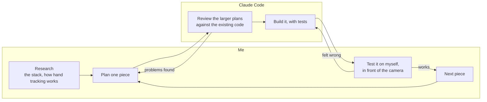
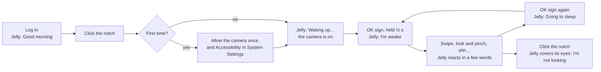
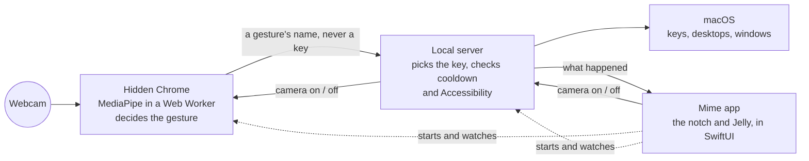
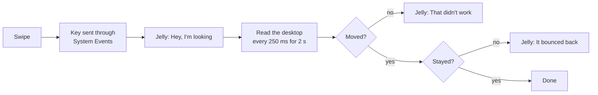
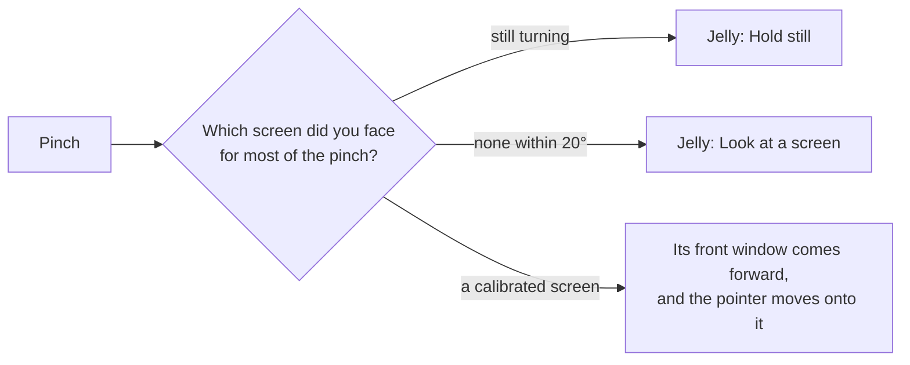
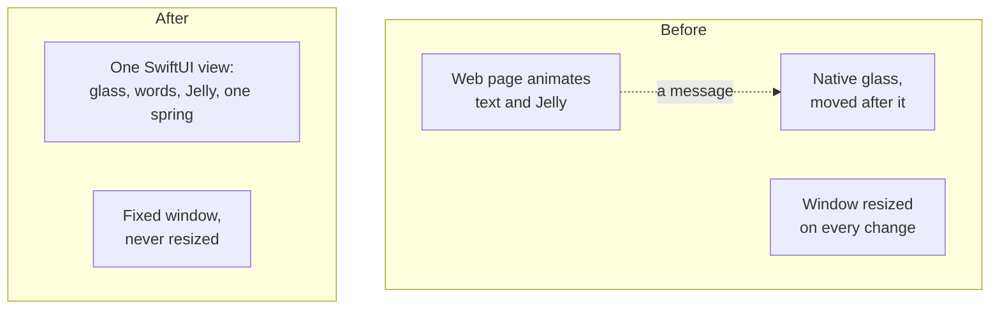

# Mime: case study deck

Slide-by-slide copy for a 14-slide deck, its visual system, eight diagrams, and a placeholder for every image and video, saying where it goes and what goes in it. The full text is in [case-study-mime.md](case-study-mime.md). The prompt that builds the PowerPoint is in [case-study-mime-deck-prompt.md](case-study-mime-deck-prompt.md).

## Deck rules

- **Format:** 16:9. Positions are in pixels on a 1920 × 1080 canvas, measured from the top left.
- **Copy limits:** headline up to 10 words, body up to 70 words, a card up to 45 words, a caption up to 12 words.
- **Copy is final.** Use it word for word. Text between `==` marks in a headline is the accent phrase.
- **No images are made for the deck.** Every image and video is a placeholder card, filled in later.
- **One diagram per slide at most.** Diagrams are built as editable shapes or native charts.

## Placeholders

There are three kinds, and the ID says which:
- **CAP: you capture it.** A screen recording, a screenshot or a photo of the real thing. Anything that shows Mime working must be real: never generate the notch, Jelly's words, a screen or a gesture.
- **GEN: you generate it.** Device frames and backgrounds only. Where Jelly appears, generate with Jelly's real art as the reference ([docs/mascot/jelly.html](mascot/jelly.html)) and check it's on model: a glossy peach-to-pink gumdrop with plum capsule eyes.
- **D: a diagram,** built in the deck.

Where a capture goes inside a generated frame, such as a screen recording inside a laptop, generate the frame with its screen empty and place the capture on top.

**The design sheet's notch scenes show the old two-line wording.** That makes them the "before" on slide 11. Never use them as the current notch.

**Each placeholder card shows:**
- its ID and kind, such as CAP-01 · VIDEO;
- one line on what goes there;
- its aspect ratio.

It sits at the exact position and size of the final image. Where one ID covers several cards, they're lettered, such as CAP-05a to CAP-05d.

## Visual system

**Clean and modern, with the reference elements kept quiet.** White first, plenty of space, plum text. Jelly's colour is an accent, about 5% of any slide. Glass and soft light are there, but subtle. The quiet look suits the product: Jelly is status, never a helper.

### Colour, from Jelly's own art

The colours come from `public/ui/mascot.svg` and the notch's light in `src-tauri/island/Sources/Island/Island.swift`.

| Role | Name | Hex |
| --- | --- | --- |
| Slide background | White | `#FFFFFF` |
| Cards and panels | Highlight | `#FFF4EC` |
| All text | Plum | `#2B1638` |
| Labels, captions, secondary text | Plum at 60% | |
| Hairlines and borders | Plum at 8% | |
| Accent text and numbers, left to right | Rose → Berry | `#F2618D` → `#D94886` |
| Full Jelly gradient, for icon tiles and diagram highlights | Cream → Peach → Coral → Rose → Berry | `#FFE7CF` `#FFC09E` `#FF9094` `#F2618D` `#D94886` |
| Soft glow | Cream → Peach | `#FFE7CF` → `#FFC09E` |
| Status, only where it means something | Gold, Red | `#FFD68C`, `#FF6969` |

**Contrast:**
- Text uses only Plum, Plum at 60%, or the Rose → Berry accent. The accent appears only at headline and stat sizes, never on body text.
- The light stops, Cream and Peach, never carry text.

**The accent is used only for:**
- the marked phrase in each headline;
- the stat numbers on slide 13;
- the small squircle icon tiles;
- highlights inside diagrams.

**One soft glow per slide at most,** in a corner and never behind text. No full-slide gradients, no dark slides, no colour blocks.

### Type

- **One family:** Inter (free, Google Fonts). Fall back to Helvetica Neue.
- **Sizes:**

  | Use | Size | Weight and spacing |
  | --- | --- | --- |
  | Cover title | 160 px | Bold, letter-spacing −2% |
  | Headline | 64 px | Semibold, line height 1.05, letter-spacing −1% |
  | Statement title (slide 4) | 32 px | Semibold |
  | Body | 28 px | Regular, line height 1.4 |
  | Card text | 22 px | Regular |
  | Caption | 18 px | Regular, Plum at 60% |
  | Label | 15 px | Medium, all caps, letter-spacing +12%, Plum at 60% |

### Cards and glass

- **Card:**
  - a rounded rectangle, radius 24 px;
  - Highlight fill, or white at 70% where it sits over the glow or an image;
  - a 1 px hairline in Plum at 8%;
  - a very soft shadow in Plum at 6%, blur 40 px, 12 px down.
- **Cards only on slides 2, 8 and 13.** Elsewhere, columns are divided by hairlines, so the deck doesn't read as a row of boxes.
- **Glass stays a hint.** Only the cover's glass ring and the two generated backgrounds (slides 4 and 14) are glass.

### Layout

- **Grid:** 12 columns, 96 px margins, 24 px gutters. Leave at least a third of every slide empty.
- **Corner labels on every slide:**
  - top left: MIME;
  - top right: the slide number, as 01 / 14;
  - bottom left: the eyebrow;
  - bottom right: CASE STUDY · 2026.
- **Headline:** at x 96, y 112, 1728 px wide, on one line. Only slide 10's takes two.
- **Faint column lines,** Plum at 4%, on slides 4 and 14 only.

### Diagrams

- **Nodes:** white with a Plum hairline, text in Plum at 22 px.
- **Lines:** thin, in Plum at 40%, with small arrowheads.
- **Accent:** the Jelly gradient only to mark the one thing a diagram is about.
- **Jelly's words** appear in quotes, in Rose.
- **The Mermaid below each is the structure,** not the look. Lay each one out to fit its box.

---

## Slide 1 · Cover

**Reference:** the 3D laptop with the mascot peeking over its screen.
**Layout:** the title, subhead and role line straight on white on the left. The hero scene fills the right, with one soft glow behind it.

**Eyebrow:** Creative technology · Spatial interaction · 2026
**Headline:** Mime
**Subhead:** A Mac you control with your hands and your head, through the webcam it already has.
**Role line:** Concept, interaction design, testing and direction · Code by Claude Code under my direction · Aug to Oct 2026

**Title block:** x 96, y 300, 680 wide.

**GEN-01 · HERO FRAME** · x 820, y 96, 1004 × 888 · about 8:7, generate at 2008 × 1776.
- A MacBook Air **without a hardware notch**, open, at a low three-quarter angle, resting on a clear glass ledge with a faint peach reflection.
- Jelly peeks over the top edge of the screen, at the centre where a notch would be, hands on the bezel. Jelly is the only strong colour in the image.
- One clear glass ring floats beside Jelly, slightly blurred.
- A white background with one soft Cream-to-Peach glow behind the laptop.
- The screen is left empty for CAP-01. The real capture is what the eye lands on.

**CAP-01 · VIDEO** · inside GEN-01's screen, filling it.
- The hero loop: look at the second screen and pinch, and its window comes forward. Then swipe: the desktop changes and Jelly says "Hey, I'm looking".
- 6 to 10 s, 16:10. A still frame for PowerPoint, the loop for Behance.

---

## Slide 2 · The problem, and Mime

**Layout:** two columns. The problem on a card over the lower third of CAP-02. Mime on a card below CAP-03.

**Eyebrow:** Why I built it
**Headline:** Every screen switch cost me ==the pen==.

**Left, the problem** (card x 120, y 680, 592 × 280): I plan my day in a notebook and work across two screens. Each time I wanted the other screen, the pen went down and my hand went to the keyboard. I'd always wondered how gesture control works, and I wanted it inside the Apple ecosystem I already use.

**Right, Mime** (card x 816, y 744, 1008 × 240): The webcam reads 21 points on your hand and the direction of your head, on the device. My MacBook Air has no notch, so Mime draws one under the camera. Jelly lives in it and says what each gesture did.

**CAP-02 · PHOTO** · x 96, y 216, 640 × 768 · 5:6.
The desk from a three-quarter angle: the notebook and pen, the laptop, the second screen.

**CAP-03 · SCREENSHOT** · x 816, y 216, 1008 × 504 · 2:1.
- The top centre of the screen: the menu bar, and Jelly at rest in the notch, on a soft wallpaper with some colour in it.
- To show the camera above it, place the capture under a generated bezel crop.

---

## Slide 3 · How I worked

**Layout:** D-08 across the slide, as two lanes, Me and Claude Code. Below it, the testing text on the left and CAP-04 on the right.

**Eyebrow:** Process
**Headline:** I directed it. ==Claude Code== wrote the code.

**D-08 · PROCESS DIAGRAM** · x 96, y 230, 1728 × 460. Two horizontal lanes, Me on top. The loop back from testing to building is the accent.

**Text** (x 96, y 740, 840 wide, at 24 px): Claude Code wrote 286 JavaScript tests that run on hands generated from geometry, and one plan review found 12 problems before anything was built. The bugs that mattered showed up on my screen: a long empty bar at rest, Jelly off-centre, stiff motion. I pointed out each one and had it rebuilt.

**CAP-04 · SCREENSHOTS, OPTIONAL** · x 984, y 730, 840 × 254.
- Two or three screenshots of those bugs, such as the long empty bar.
- If you didn't keep them, delete the card and widen the text.

---

## Slide 4 · What I believed

**Reference:** the concentric glass domes.
**Layout:** three statements in columns divided by hairlines, with no cards, above the domes. Faint column lines.

**Eyebrow:** Point of view
**Headline:** Three beliefs behind ==the decisions==.

Columns at y 330, each 552 wide, at x 96, 684 and 1272. Each has a statement title at 32 px, then its text at 24 px:

| Models guess. The OS executes. | Status, never a helper. | Measure before redesigning. |
| --- | --- | --- |
| A hand MediaPipe sees is only a guess. The product is deciding when to act on it, and checking the action happened. | Jelly only shows what already happened. It never interrupts or asks for anything. | I learned this when the first version failed. Nothing changes until a measurement says what to change. |

**GEN-02 · BACKGROUND** · the whole slide · 16:9, generate at 3840 × 2160.
- Three concentric glass domes rising from the bottom edge, their tops about 40% up from the bottom.
- Clear frosted glass with a faint peach tint, soft light from the top left, very fine grain.
- The top half plain white, for the text.
- Replace the slide's background with it.

---

## Slide 5 · User flow

**Layout:** one line under the headline, then D-01, then CAP-05 along the bottom, joined by a thin arrow.

**Eyebrow:** User flow
**Headline:** Click to start, OK sign to arm, ==then gesture==.
**Body** (x 96, y 210, 1728 wide): Nothing presses a key until you arm it, and every gesture gets a few words back.

**D-01 · USER FLOW** · x 96, y 300, 1728 × 440. Laid out left to right. The arm step is the accent.

**CAP-05 · FOUR SCREENSHOTS** · y 800, each 408 × 136, at x 96, 536, 976 and 1416 · 3:1.
- The notch saying "Good morning", "Waking up…", "I'm awake" and "Going to sleep".
- To get "Good morning", sleep the Mac for over a minute.

---

## Slide 6 · The gestures

**Reference:** the squircle app icons.
**Layout:** the body under the headline, then seven squircle tiles in a row. Under each tile, a caption block: the gesture in bold, what it does, Jelly's reply in Rose, and a small outline pill saying where the gesture came from: Study, Apple, Live or Candidate.

**Eyebrow:** The gesture set
**Headline:** Seven movements, ==each with a reason==.
**Body** (x 96, y 210, 1728 wide): The first set came from guesswork, and a held open palm locked my Mac by accident. I rebuilt it: two gestures from published studies, two from Apple, two chosen after trying them live, and one still a candidate.

| Tile | Gesture | Does | Jelly says | Pill | Why, in the speaker notes |
| --- | --- | --- | --- | --- | --- |
| CAP-06 | OK sign, held ½ s | Arm / disarm | I'm awake / Going to sleep | Study | "Yes" in a mid-air TV gesture study (Dim et al., DIS '16) |
| CAP-07 | Look + pinch | Bring that screen's window forward | Over there | Apple | Vision Pro's select, with the head for the eyes |
| CAP-08 | Swipe left / right | Next / previous desktop | Hey, I'm looking | Apple | Like the trackpad |
| CAP-09 | Swipe up / down | Page down / up | Down we go / Up we go | Study | Palm up and down (Dim et al., DIS '16) |
| CAP-10 | Shh, 0.4 s | Mute in Zoom | Shh | Candidate | Kept only with 90% success in the check-up, which hasn't run yet |
| CAP-11 | Fist | Lock the screen | See you soon | Live | Chosen live. A thumbs-up can read as a fist |
| CAP-12 | Open palm, held still 1.2 s | Play / pause music | Got it | Live | Chosen live |

**CAP-06 to CAP-12 · SEVEN VIDEOS** · y 380, each 216 × 216, at x 96, 348, 600, 852, 1104, 1356 and 1608 · 1:1, rounded as squircles.
One hand making the gesture on a plain light background, filmed from the laptop's point of view. 2 s loops.

---

## Slide 7 · How it's built

**Layout:** D-02 across the top. Three columns below, divided by hairlines.

**Eyebrow:** Architecture
**Headline:** Three processes, and ==no frame leaves the Mac==.

**D-02 · ARCHITECTURE** · x 96, y 230, 1728 × 480. The accent is the line between the page and the server, labelled "a gesture's name, never a key".

Columns at y 760, each 552 × 220:

| Hidden Chrome | Local server | Mime app |
| --- | --- | --- |
| MediaPipe runs in a Web Worker, the only setup measured to keep detecting with the window hidden. I kept Chrome for that. | Gets a gesture's name, never a key. It picks the key, then checks cooldown and Accessibility. | Draws the notch and Jelly in SwiftUI and keeps the other two running. The cost: Chrome and Node must be installed. |

---

## Slide 8 · Turning guesses into actions

**Layout:** the body under the headline, two cards side by side, and D-03 across the bottom.

**Eyebrow:** The logic
**Headline:** Two rules keep gestures ==from colliding==.
**Body** (x 96, y 210, 1728 wide): MediaPipe gives 21 noisy points every frame, and some gestures share frames: a swipe passes through the open-palm shape on its way. I separated them with two rules.

Cards at y 330, each 852 × 310, at x 96 and 972:

| Time | Trust |
| --- | --- |
| A pose counts once it's held: 180 ms, ½ s for the OK sign, 1.2 s still for an open palm. A hand moving faster than 0.8 palm widths a second is never a pose. Holds stay short, since arm fatigue is the cost of mid-air input (Hincapié-Ramos et al., CHI '14). | Decisions use only the points the camera sees reliably. The thumb's are the least reliable, so a swipe ignores it. Distances are in palm lengths, so a gesture works near or far. |

**D-03 · TIMELINE** · x 96, y 690, 1728 × 290.
- One open hand along a time axis, splitting into two branches.
- It sweeps sideways faster than 0.8 palm widths a second: a swipe.
- It holds still for 1.2 s: play / pause.
- Hold bars in the Jelly gradient.

---

## Slide 9 · Switching desktops

**Layout:** the body and the table card on the left, the laptop on the right, and D-05 across the bottom.

**Eyebrow:** The hidden work
**Headline:** Five ways to switch a desktop. ==One held.==
**Body** (x 96, y 210, 840 wide): Switching desktops looks like the simplest gesture, and it took far more work than any other. macOS got the key press, and the app in front even reacted, but the desktop stayed put. I had five methods tested against the window server's own record.

Table card at x 96, y 440, 840 × 360. A Gold dot beside the last row:

| Method | Did the desktop move? |
| --- | --- |
| nut.js, two ways | Never |
| A Swift helper sending real key events | Never |
| A private window-server call | Yes, but it could snap back |
| A simulated trackpad swipe | Yes, but it sometimes snapped back |
| macOS System Events | Yes, and it stayed, with no private API |

**GEN-04 · LAPTOP FRAME** · x 1040, y 216, 784 × 560 · 7:5, generate at 1568 × 1120, transparent.
A MacBook Air **without a hardware notch**, open, seen straight on, with the screen left empty.

**CAP-13 · VIDEO** · inside GEN-04's screen.
- A swipe slides to the next desktop while the notch opens and Jelly says "Hey, I'm looking".
- 4 to 6 s, 16:10.

**D-05 · CHECK LOOP** · x 96, y 830, 1728 × 154, text at 18 px. One row from left to right, with each "no" as a short branch below its check. The "stayed?" check is the accent. A caption along the bottom of the box: "macOS can pull a desktop back about 1.5 s later, so Mime watches for 2 s."

---

## Slide 10 · What I killed: pointing

**Layout:** CAP-14 on the left, corners rounded 24 px. On the right, the body, D-07, and one line under it. A small Red "×" chip sits after the word "Pointing" in the headline.

**Eyebrow:** What I killed
**Headline:** Pointing fired zero times. ==Look and pinch== replaced it.
**Body** (x 760, y 300, 1064 wide): In its first live test, pointing fired zero times in about 80 seconds. My best guess: a finger aimed at a screen is aimed at the camera too, which sees it end-on. Mime now borrows Vision Pro's look and pinch, with head direction standing in for eye tracking.

**D-07 · PINCH DECISION** · x 760, y 560, 1064 × 300. The "yes" path is the accent.

**Line under it** (x 760, y 884, 1064 wide, caption size): Calibration takes about two seconds per screen. A four-minute check-up to score it is built, and hasn't been run yet.

**CAP-14 · VIDEO** · x 96, y 280, 563 × 704 · 4:5.
- Filmed over the shoulder. Turn from the laptop to the second screen and pinch: its window comes forward and the pointer jumps onto it.
- Then look down at the notebook and pinch: Jelly says "Look at a screen".
- 6 s.

---

## Slide 11 · Meet Jelly

**References:** the squircle icons, for the concept strip.
**Layout:** on the left, the text and rules with no card, divided from the right by a hairline. On the right, the concept strip on top and the before and after of Jelly's words below it. The reactions table goes in the speaker notes.

**Eyebrow:** The mascot
**Headline:** Jelly is Mime's status, ==with a face==.

**Text** (x 96, y 230, 760 wide, at 24 px): Mime runs in the background, so the notch is the only place you see it. I directed four rounds of concepts and picked Jelly over a droplet and a glowing orb: a glossy peach-to-pink gumdrop with plum eyes. Its first words were two lines of detail. I cut them to a few words in its voice.

**Rules** (under the text):
- It only reacts to what already happened, and never offers help.
- Its eyes look at your screens, never at you: a face behind a camera that stares back is unsettling.
- Every mood has words, and VoiceOver reads the full detail.
- With Reduce Motion on, nothing animates.

**CAP-19 · CONCEPT STRIP** · x 920, y 230, 904 × 300.
- Screenshots of the exploration, in order, joined by thin arrows: the 15 rough ideas, the concept rounds, and Jelly before and after its refinement.
- Captioned "15 ideas → 14 concepts over four rounds → Jelly".
- From `docs/mascot/`: `ideas.html`, `concepts.html` to `concepts-4.html`, and the "Before and after" in `jelly.html`.

**CAP-20 · BEFORE AND AFTER** · x 920, y 580, 904 × 404, two halves.
- Left, labelled Before: the old two-line notch from the design sheet's glass island.
- Right, labelled After: the real notch with Jelly saying "Hey, I'm looking".

**Speaker notes, the reactions table:**

| You | Jelly says | Face |
| --- | --- | --- |
| Arm with the OK sign | I'm awake | Winks |
| Disarm | Going to sleep | Eyes shut, "z z" |
| Swipe to a desktop | Hey, I'm looking | A happy bounce |
| Swipe up / down | Down we go / Up we go | Happy |
| Look and pinch | Over there | Happy |
| Fist to lock | See you soon | Happy |
| Shh | Shh | Happy |
| A refused gesture | Look at a screen, Hold still… | A shrug |
| Camera off | I'm not looking | Covers its eyes |

Its glow turns gold when a gesture works, amber for a warning and red for a problem.

---

## Slide 12 · Going native for smoothness

**Layout:** CAP-16 across the top. Under it, the body on the left, D-04 in the middle and the spec card on the right.

**Eyebrow:** The risky call
**Headline:** The notch felt stiff, so I ==had it rebuilt natively==.
**Body** (x 96, y 690, 760 wide): The first notch was a web page with macOS glass behind it, and it felt laggy and stiff. The causes were structural: two animations in two processes, and a window resized on every change. SwiftUI was new to the project, and the first try crashed at launch.

**D-04 · BEFORE AND AFTER** · x 896, y 690, 520 × 294. Two small stacks side by side. The "after" stack is the accent.

**Spec card** (x 1440, y 690, 384 × 294, caption size):
- Pattern and spring values from boring.notch, studied alongside DynamicNotchKit; none of their code
- Opening spring: response 0.42, damping 0.8
- Closing spring: response 0.45, damping 1.0, no bounce
- Glass: Apple's Liquid Glass, clear
- Reduce Motion on: no animation

**CAP-16 · VIDEO** · x 96, y 216, 1728 × 432 · 4:1.
- The notch close up on a soft wallpaper with some colour in it. Two gestures in quick succession, so the spring changes course mid-motion.
- Record at 60 fps, and also export a copy at half speed so the spring is easy to see.

---

## Slide 13 · Results

**Layout:** four cards across the top: three stats and one chart. Under them, three short paragraphs.

**Eyebrow:** Outcome
**Headline:** In daily use, and it worked for ==one friend==.

Cards at y 230, each 408 × 250, at x 96, 536, 976 and 1416:

| 61% → 19% | D-06 | 5 → 1 | 286 + 5 |
| --- | --- | --- | --- |
| CPU of one core across all of Mime's processes: camera on, no hand in view, 60 s average. MacBook Air M1 | The chart | Ways to switch desktops tested, and the one that held | JavaScript and Rust tests, no camera needed |

**D-06 · CHART** · inside the second card. A native horizontal bar chart titled "Runs a second, window hidden":
- animation loop, 0;
- video frame callback, 0;
- page timer, 1.5;
- page timer while playing audio, 1.5;
- Web Worker timer, 62.5.

The Web Worker bar is the accent; the rest are Plum at 20%.

**Below** (x 96, y 530, 1728 wide, at 24 px, three paragraphs):
- A friend tried Mime on my Mac after a quick demo, and it worked for them too. That's one person, on my setup.
- The pen problem is only partly solved. The pen still goes down, but my hand goes up instead of across to the keyboard. It's untimed: a CHI 2005 study found switching monitors by head direction made tasks slower, so a timed test against the mouse comes after the check-up runs with three to five people.
- Limits: one hand, the built-in camera, macOS only, and Chrome and Node must be installed. A thumbs-up reads as a fist. Not yet tested with anyone who has limited hand movement.

---

## Slide 14 · What I learned

**Reference:** the editorial poster with the glass mosaic.
**Layout:** the headline at the top left. Two columns of points divided by a hairline, with no cards. The mosaic fills the bottom third, with CAP-18 resting on it at the right. Faint column lines. The source link is an outline pill chip at the bottom left.

**Eyebrow:** Reflection
**Headline:** With an AI writing code, ==I define "working"==.

**Left column** (x 96, y 300, 840 wide). **I'd do differently:**
- Measure earlier. The first version was built on feel and failed its first real test.
- Start from research. One guessed gesture locked my Mac by accident.
- Go native earlier. I rebuilt the web notch anyway.

**Right column** (x 984, y 300, 840 wide). **What changed:**
- My job became deciding what "working" means, and proving it. A desktop swipe works when the desktop moves and stays.
- MediaPipe's hand model was the easy part. The decisions around it are the design.
- Smoothness was an engineering problem, solved by one native view in a window that never resizes.

**Footer chip:** github.com/Abhi-desig/Gesture (Mime's working name was Gesture)

**GEN-07 · BACKGROUND** · the whole slide · 16:9, generate at 3840 × 2160.
- A grid of frosted white glass tiles filling the bottom third, with a faint peach glow along the bottom edge only.
- The rest plain white, for the text.
- Replace the slide's background with it.

**CAP-18 · PHOTO** · x 1296, y 624, 528 × 352 · 3:2.
The laptop on your desk, front view, Jelly at rest in the notch.

---

## Placeholder list

Grouped so each kind can be done in one sitting. Record the screen at full resolution and 60 fps. Use a soft wallpaper with some colour in it for anything showing the notch, so the glass has something to bend.

| ID | Slide | Kind | What | Ratio |
| --- | --- | --- | --- | --- |
| CAP-01 | 1 | Screen recording | Hero: look and pinch, then swipe and "Hey, I'm looking" | 16:10 |
| CAP-13 | 9 | Screen recording | Desktop swipe with Jelly's reply | 16:10 |
| CAP-16 | 12 | Screen recording | Two quick gestures, the spring changing course, plus a half-speed copy | 4:1 |
| CAP-03 | 2 | Screenshot | Jelly at rest in the notch | 2:1 |
| CAP-05 | 5 | Four screenshots | "Good morning", "Waking up…", "I'm awake", "Going to sleep" | 3:1 each |
| CAP-19 | 11 | Screenshots | The mascot exploration, from `docs/mascot/` | 3:1 strip |
| CAP-20 | 11 | Two screenshots | Before: the design sheet's two-line notch. After: the real notch | 9:4 |
| CAP-04 | 3 | Screenshots, optional | The bugs you caught, if you kept them | any |
| CAP-02 | 2 | Photo | The desk: notebook, pen, laptop, second screen | 5:6 |
| CAP-14 | 10 | Video | Over the shoulder: look and pinch, then a pinch at the notebook | 4:5 |
| CAP-06 to CAP-12 | 6 | Seven videos | One gesture each, plain background | 1:1 |
| CAP-18 | 14 | Photo | The laptop on the desk, Jelly at rest | 3:2 |
| GEN-01 | 1 | Generated | Hero frame: notchless MacBook Air, Jelly peeking over the screen, one glass ring, empty screen | 8:7 |
| GEN-02 | 4 | Generated | Background: concentric glass domes | 16:9 |
| GEN-04 | 9 | Generated | Laptop frame: notchless MacBook Air, straight on, empty screen, transparent | 7:5 |
| GEN-07 | 14 | Generated | Background: glass tile mosaic | 16:9 |
| D-01 to D-08 | 3, 5, 7, 8, 9, 10, 12, 13 | Diagram | Process, user flow, architecture, timeline, check loop, pinch decision, notch before and after, hidden-window chart | built in the deck |
