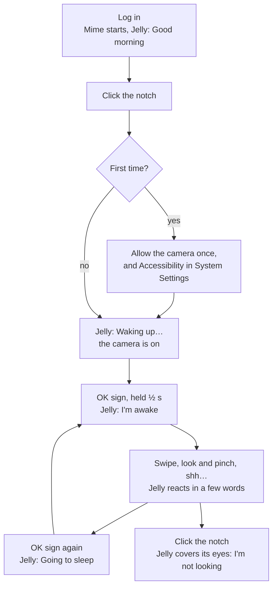
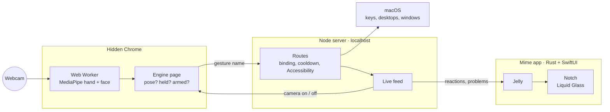

# Mime

I plan my day in a notebook, with a pen, and I work across two screens. Every time I wanted the other screen, the pen went down and my hand went to the keyboard. I'd always wondered how gesture control really works, and I wanted it inside the Apple ecosystem I already live in, so I built it.

Mime watches your hand and your head through the laptop's webcam. You swipe to change desktops, or look at a screen and pinch to bring its window forward, and an OK sign switches Mime on or off. A small notch of Liquid Glass under the camera holds Jelly, a mascot that shows what Mime sees and says what it just did.

Claude Code wrote the code. I designed Mime, tested every change on myself in front of the camera, and decided when each part was done.

<!-- VIDEO: Hero
     Capture: one take at the desk. Notebook in front. Look at the second screen and pinch: its window comes forward. Swipe: the desktop changes and Jelly says "Hey, I'm looking".
     Specs: 6 to 10 s, muted, loop, .mp4, cropped to show the hand and both screens
     Tip: Screen Studio for the screen, a phone on a tripod for the desk -->

| Role | Built with | Timeline | Status |
| --- | --- | --- | --- |
| Concept, interaction design, testing, direction. Code by Claude Code. | MediaPipe (on-device), Chrome Web Worker, Node.js, Swift and SwiftUI, Rust (Tauri) | 4 Aug to 26 Oct 2026 | Runs on my Mac every day, from login. A friend has tried it too |

## How you use it

Mime starts with the Mac and greets you from the notch. One click turns the camera on, and an OK sign arms it, so nothing presses a key until you mean it to. From then on, every gesture that works gets a few words from Jelly, and every one that's refused gets a shrug and a reason.

<!-- IMAGE: Behance doesn't render Mermaid. Export this diagram as a PNG at mermaid.live, or redraw it -->



## How I worked

I started by researching the subject: which stack to use and how hand tracking actually works. Then I planned one piece at a time, had Claude Code build it, and debugged it before moving on. Before building, I had the larger plans reviewed against the existing code, and one review found 12 problems in a draft.

Claude Code wrote 286 tests alongside the code. They run on hands generated from geometry, because the decision logic is kept apart from the camera. They caught logic errors, but the bugs that mattered most showed up on my screen: at rest the notch stretched into a long empty bar, Jelly sat off-centre, and the motion felt stiff. Each time I pointed out what was wrong, with a screenshot where I could, and had that part rebuilt.

## What I believed

Models guess, and the operating system executes. A hand MediaPipe sees is only a guess. The product is deciding when a guess is safe to act on, and checking that the action really happened.

The mascot is status, never a helper. Jelly only shows what already happened, and it never interrupts or asks for anything.

I learned the third belief when the first version failed: measure before redesigning.

## How it's built

Mime runs as three processes on the Mac, and no camera frame leaves it. A hidden Chrome runs the camera and MediaPipe. A local Node server turns gesture names into key presses. The page only ever sends a name like `swipe_left`, and the server alone decides which key that presses. The Mime app draws the notch in SwiftUI and keeps the other two running.

<!-- IMAGE: export this diagram as a PNG for Behance -->



The hardest constraint was the hidden window. Mime works while you're in another app, and browsers throttle a page you can't see. With the window hidden, the page's animation loop and its per-frame video callback ran 0 times a second, and timers ran 1.5 times. A timer inside a Web Worker ran 62.5 times. Tauri's own web view couldn't detect while hidden at all, so detection runs in a Chrome of Mime's own, kept out of sight. Apple's Vision framework has its own hand-pose API, and a native engine is a possible later step.

## Turning guesses into actions

The first gesture set taught me the cost of a bad guess. An open palm, held, used to lock the screen, and it locked my Mac by accident: an open palm is also how a hand rests and waves. I rebuilt the set from published gesture studies, such as a study of mid-air TV gestures where the OK sign meant "yes" (Dim et al., DIS '16). Later, after living with it, I moved play and pause to a held open palm and the lock to a fist.

MediaPipe gives 21 points on the hand every frame, with noise, and some gestures share frames. A swipe passes through the open-palm shape on its way, so the same frames can look like either. I separated them with two rules.

The first is time. A pose has to be held before it counts: 180 ms by default, half a second for the OK sign, and 1.2 seconds held still for an open palm. A hand moving faster than 0.8 palm widths a second is never a pose, so a swipe can't trigger it.

The second is trust. Decisions only use the points the camera sees reliably. The thumb is MediaPipe's least reliable point, so a swipe ignores it entirely. Every distance is measured in palm lengths, which lets a gesture work close up or at arm's length.

## Switching desktops

Switching desktops looks like the simplest gesture, and it took far more work than any other. macOS received the key press, and the app in front even reacted to it, but the desktop didn't move. I had five ways of sending it tested against the window server's own record of the current desktop:

| Method | Did the desktop move? |
| --- | --- |
| nut.js, two ways | Never |
| A Swift helper sending real key events | Never |
| A private window-server call | Yes, but it could snap back |
| A simulated trackpad swipe | Yes, but it sometimes snapped back |
| **macOS System Events** | **Yes, and it stayed** |

System Events was the only one that held without private API. Sending the key still didn't prove the desktop moved, because macOS can move it and then pull it back about 1.5 seconds later. So after every swipe, Mime reads the current desktop four times a second for two seconds, and Jelly says so if it never moved or didn't stay:

<!-- IMAGE: Behance doesn't render code. Screenshot this block with a code-image tool -->

```js
// server/index.js: a Space can move, then be pulled back ~1.5 s later
while (performance.now() < deadline) {
  await sleep(SPACE_POLL_MS); // 250 ms
  const now = await windowServerSpacesAsync();
  if (!now) continue;
  latest = now;
  if (now.active !== before.active) sawChange = true;
}
return { moved: sawChange, held: latest.active !== before.active /* … */ };
```

## Dropping point for look and pinch

The first version let you point at a screen to pick it. In its first live test, pointing fired zero times in about 80 seconds. My best guess is that a finger aimed at a screen is also aimed at the camera, which sees it end-on.

I replaced it with Vision Pro's look and pinch, with head direction standing in for its eye tracking: the head says where and the hand says what. You calibrate once by looking at each screen for about two seconds. After that, Mime acts on the screen you faced for most of the pinch, brings its front window forward and moves the pointer onto it. Pinch mid-turn and Jelly says "Hold still". Pinch while looking at the notebook and it does nothing.

I also had a check-up built: four minutes of spoken prompts that score how often Mime picks the right screen and how reliably each gesture is seen.

<!-- VIDEO: Look, then pinch
     Capture: turn from the laptop to the BenQ, pinch. The window on the BenQ comes forward and the pointer jumps onto it. Then look down at the notebook and pinch: nothing happens, Jelly says "Look at a screen".
     Specs: 6 s, muted, loop, .mp4
     Tip: film over the shoulder so the head turn and both screens are in frame -->

## Jelly

Mime runs in the background, so the notch is the only place you see it. My MacBook Air has no hardware notch, so Mime draws one. I compared three shapes and chose a notch fused to the top edge, because a floating ball would sit below the menu bar, over my work. It grows sideways when it speaks and never down.

Jelly came out of 15 rough ideas and 14 drawn concepts over four rounds. I picked it from the last round, over a droplet and a glowing orb. Its face carries the state: it covers its eyes when the camera is off, sleeps when Mime is disarmed, bounces when a gesture lands and shrugs when one is refused. Its eyes follow the screen you face and never look at you, because a face behind a camera that stares back is unsettling.

The first version of the notch spoke in two lines of detail, like "Swipe up · page down" over "Armed · facing BenQ". It said too much and took too much of the screen, so I cut it back to a few words in Jelly's voice, beside it: "I'm awake", "Going to sleep", "Hey, I'm looking", "See you soon".

<!-- SCREENSHOT: Jelly's moods
     Capture: the notch at rest, then speaking ("I'm awake", "Going to sleep", "Hey, I'm looking"), on a light and a dark wallpaper
     Specs: 1400 px wide, crop to the top 120 px of the screen, dark and light variants
     Tip: docs/mascot/jelly.html shows every mood if a live capture is hard -->

## Going native for smoothness

The first notch was drawn by a web page, with macOS glass placed behind it, and to me it felt laggy and stiff. When I looked into why, the causes were in the structure: two animations in two processes drifting apart, a window resized on every open and close, and a fixed curve that lost its speed whenever a new message interrupted it.

I had the source of two open-source notch apps read, boring.notch and DynamicNotchKit. Both create their window once, never resize it, and animate with SwiftUI springs inside it. I took that pattern and boring.notch's spring values, but none of their code: opening at response 0.42 and damping 0.8, closing at 0.45 and 1.0, so it closes without a bounce.

Rebuilding the notch in SwiftUI meant linking Swift into the app for the first time. It felt risky, and the first attempt crashed the app at launch. The version that shipped is one SwiftUI view with Apple's Liquid Glass, and Jelly and the glass move in the same frame.

<!-- VIDEO: The native notch
     Capture: two gestures in quick succession, so the spring retargets mid-motion. The web notch was never committed, so there's no "before" to record; use a screenshot of it if you kept one
     Specs: 6 s, muted, loop, .mp4
     Tip: screen-record at 60 fps so the spring is visible -->

## Who it works for

Mime needs a hand raised in front of the camera, so it isn't for everyone. Here is what I built in:
- nothing presses a key until you arm it;
- every mood has words, and VoiceOver reads the full detail;
- with Reduce Motion on, the notch changes without animating;
- holds stay short, 1.2 seconds at most, since arm fatigue is the known cost of mid-air input (Hincapié-Ramos et al., CHI '14).

The limits:
- it tracks one hand at a time, through the built-in camera, on macOS only;
- it needs Chrome and Node installed;
- a thumbs-up still reads as a fist, which locks the screen;
- I haven't tested it with anyone who has limited hand movement.

## Results

Mime runs on my Mac every day and starts at login. A friend tried it on my Mac after a quick demo, and it worked for them too. That's one person, on my setup.

| With the camera on and no hand in view (MacBook Air M1) | Before | After |
| --- | --- | --- |
| CPU, % of one core | 61 | 19 |
| Frames checked a second | 31.9 | 8.7 |

Most of that cut came from checking the camera about 8 times a second while no hand is in view, and returning to every frame as soon as one appears. The rest came from smaller frames (640 × 360 instead of 1280 × 720, since MediaPipe shrinks every frame to 256 px or less anyway), from sending 8 face points instead of 478, and from drawing nothing while the window is hidden.

Did it fix the pen problem? Partly. The pen still goes down. My hand goes up in front of the camera instead of across to the keyboard, and look and pinch acts on the screen I'm already facing. I haven't timed it. A CHI 2005 study found that switching monitors by head direction made tasks slower, so a timed test against the mouse comes after the check-up runs with three to five people.

## What I'd do differently

I'd measure earlier. The first version was built on feel, and it failed its first real test.

I'd start from research. The first gesture set came from guesswork, and one of its gestures locked my Mac by accident.

I'd go native earlier. The web notch took real work, and I rebuilt it anyway.

## What this changed

With an AI writing the code, my job became deciding what "working" means and proving it. A desktop swipe works when the desktop moves and stays, which is more than a key being sent.

MediaPipe's hand model was the easy part. The decisions around it are the design.

How smooth something feels turned out to be an engineering problem. The fix for the stiff notch was one native view in a window that never resizes.

---

Source: [github.com/Abhi-desig/Gesture](https://github.com/Abhi-desig/Gesture) (Mime's working name was Gesture)
